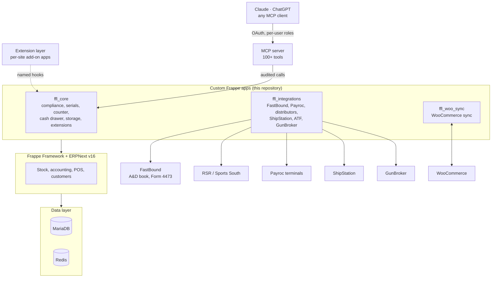

<div align="center">

# OpenGunstore

**A point of sale and back office for licensed firearm retailers, built on Frappe / ERPNext v16, with support for AI assistants.**

[opengunstore.com](https://opengunstore.com)

[](LICENSE)
[](https://github.com/frappe/frappe)
[](https://github.com/frappe/erpnext)
[](docs/versions.md)
[](#ai-native)
[](https://github.com/Old-Steel-Arsenal/opengunstore/actions/workflows/release-image.yml)

[AI-native](#ai-native) · [Features](#features) · [Architecture](#architecture) · [Quick start](#quick-start) · [Self-hosting](#self-hosting) · [AI deployment](#deploying-with-an-ai-assistant) · [Extensions](#extensions) · [Contributing](#contributing)

</div>

---

## Why

Running a gun store means selling from one inventory of serialized firearms through several channels (the counter, a website, an auction marketplace) while keeping a federally mandated bound book and a Form 4473 for every transfer. OpenGunstore puts the counter, the books and the channels in one system, with the compliance rules enforced in the sale flow rather than left to memory. It was originally built for an independent firearm retailer and runs in production there.

It is a set of Frappe apps on top of stock ERPNext. ERPNext stays the source of truth for inventory, customers and accounting; the apps never patch Frappe or ERPNext core and customize only through Frappe's own extension points (doc events, custom-field fixtures, client scripts, whitelisted methods).

## AI-native

Staff, owners and accountants can work with the store through an AI assistant. The assistant signs in as a person, works within that person's roles, and every call it makes is logged.

### Bring your own assistant

The POS is an OAuth authorization server for the [Model Context Protocol](https://modelcontextprotocol.io). Claude (claude.ai, Claude Desktop, Claude Code), ChatGPT or any other MCP client connects to the store's connector URL and signs in with a POS account. It then works through the [GunStore MCP server](https://github.com/Old-Steel-Arsenal/opengunstore-mcp), which has more than a hundred tools covering inventory, orders, receiving, the cash drawer, stock counts, distributors and accounting reports.

- Each call runs as the signed-in user, with that user's permissions.
- A read-only connector for the accountant exposes 27 reporting tools and no write tools; the full connector has 108 (111 when the store turns on GunBroker actions).
- Every call is recorded in a permanent *Connector Audit Log* before it executes, with credentials redacted.
- Tools that move money or stock, or change compliance state, require explicit confirmation.
- Both connectors are off by default and are enabled per store in *MCP Settings*.

Example questions:

- *Which guns have been in stock for more than 90 days, and what did we pay for them?*
- *What do we owe in sales tax for September?*
- *Receive this distributor invoice and list what is still back-ordered.*

The maintainers also run private extensions that are not part of this repository. The [extension layer](#extensions) is how a site adds its own.

## Features

| Area | What you get |
|---|---|
| **Counter** | Register built on ERPNext's POS with serial-number selection, driver's-license barcode (AAMVA) scanning, pending and web-order queues, a recycle bin for deleted drafts, and in-app notifications. |
| **Serialized firearms** | Every gun is a tracked serial with its own cost, photos, storage position and channel listings; a guard refuses firearm items that are not serial-tracked. |
| **Compliance** | Acquisitions and dispositions feed the bound book (A&D) through [FastBound](https://www.fastbound.com/). Submitting a firearm sale is blocked until the Form 4473 is complete and the NICS result is Proceed. Completed 4473s are kept as permanent records with a PDF copy. |
| **FFL verification** | FFL numbers are looked up and verified against ATF eZ Check data, cached locally. |
| **Trade-ins and buys** | Individual trade-ins as credit or pay-now, with the acquisition recorded for the bound book; receiving from suppliers by scan. |
| **Consignment** | Consignor intake with a payable to the consignor, settled on sale. |
| **Cash drawer** | Drawer entries and payouts, counted daily close with a variance threshold, undo, and a weekly report. |
| **Payments** | Card-present payments on a Payroc terminal (cancel mid-flight, void, multi-card), plus daily reconciliation against the processor. |
| **Distributors** | Catalog search, quotes, ordering and drop-ship with RSR and Sports South, routed per item by fulfillment policy. |
| **Shipping** | ShipStation integration for labels and tracking. |
| **WooCommerce** | Pushes products, per-serial listings and stock to the store, ingests web orders, refunds and shipment status, with on-demand reconcile and pull-back per product. |
| **GunBroker** | List serialized guns, pull orders and fulfil them from the same inventory. |
| **Stock operations** | Inventory counts (serials reported, non-serialized quantities adjustable) and a storage-location map with zones, positions and scan-to-move. |
| **Extensions** | Optional add-on apps installed per site from the UI, checked by a linter before they run. See [Extensions](#extensions). |
| **AI assistants** | Claude, ChatGPT and any MCP client connect with per-user OAuth. Every call audited. See [AI-native](#ai-native). |
| **API reference** | Generated OpenAPI and Redoc reference for every whitelisted method, kept fresh by CI: [`docs/api/`](docs/api/README.md). |

## Jurisdictions

Two states' rules are built in. **Texas:** the sales-tax return worksheet and the tax on trade-ins. **California:** the firearm excise tax and the rule that shipping charged at cost is not taxed. Every other state runs on configuration: set up your state's tax templates in ERPNext. The shop's home state is read from the Company's address, and a Company with no address is refused when the POS has to tell in-state from out-of-state, rather than assumed to be in some default state.

## Architecture



| App | Owns |
|---|---|
| [`ffl_core`](apps/ffl_core) | Firearm and serial rules, acquisition and disposition records, the Form 4473 workflow, trade-ins and receiving, consignment, cash drawer, inventory counts, storage locations, the extension layer, release notes. |
| [`ffl_integrations`](apps/ffl_integrations) | Outbound integrations: FastBound, Payroc, RSR, Sports South, ShipStation, ATF eZ Check, GunBroker, and the client for the shared catalog data service. |
| [`ffl_woo_sync`](apps/ffl_woo_sync) | The WooCommerce connector: product and stock push, order intake, refunds, fulfilment status. |

Pinned versions of Frappe, ERPNext and the rest of the stack: [`docs/versions.md`](docs/versions.md).

## Quick start

For local development (to run it on a server, see [Self-hosting](#self-hosting)). You need Docker, git, GNU make and a host `python3`. Every entry point is a Makefile target (`make help` lists them); do not run `docker compose` directly.

```bash
make dev-up                # start the containers (MariaDB, Redis, bench)
make dev-bench-init        # one time: initialize the bench with Frappe + ERPNext
make dev-site-create       # create the dev.localhost site (admin password: admin)
make dev-install-our-apps  # install ffl_core, ffl_integrations, ffl_woo_sync
make dev-serve             # serve in the foreground at http://dev.localhost:8000
```

Day to day use `make dev-up`, `make dev-down`, `make dev-logs` and `make dev-shell`; `make dev-reset` wipes everything.

<details>
<summary>Working in a git worktree</summary>

`make dev-up && make dev-bench-clone` clones the main checkout's bench into its own containers and database volume, so several checkouts can run tests side by side (`make dev-names` shows which project you are on, `make dev-down-volumes` releases it). On macOS the clone takes seconds (APFS copy-on-write); elsewhere it is a full copy. A worktree publishes no ports by default; start it with `make dev-up PORT_OFFSET=10` and `make dev-serve` to reach it at http://dev.localhost:8010.

</details>

### Tests and API docs

```bash
make test              # JS unit tests + the full suite for all three apps, in parallel (WORKERS=6; make test-serial for one site, in order)
make ci-upgrade-test   # upgrade the dev bench to the latest v16 Frappe/ERPNext, then re-run the suite
make api-docs          # regenerate docs/api/ after changing an endpoint or docstring
```

The suite must be green twice in a row on the same site; the rules and known traps are in [`docs/testing.md`](docs/testing.md). CI fails when the generated API docs are stale (`make api-docs-check`).

## Self-hosting

Production runs as one immutable container image containing Frappe, ERPNext and the three apps, built from [`deploy/prod/Dockerfile`](deploy/prod/Dockerfile). This project does not publish an image to pull. You build your own.

- **Compose files and helpers:** [`deploy/prod/`](deploy/prod/), with a reverse-proxy example (`Caddyfile.example`) alongside.
- **Pinned upstream versions:** [`deploy/prod/frappe-refs.env`](deploy/prod/frappe-refs.env) is the single source for the image build and for CI's test benches, so tests run on exactly what ships.
- **Upgrades:** `deploy/prod/auto_deploy.sh <image-tag>` pulls the image, restarts the stack, runs `bench migrate` and clears the cache.
- **Install, backups and restore, upgrades, extensions and rollback:** the [self-hosting guide](docs/self-hosting.md). Integration credentials live in Desk settings in the database; they are never committed.
- **What needs the Data Service and what does not** (distributor catalog, offers, national FFL search, update feed), and the experimental local-catalog option: [`docs/data-service.md`](docs/data-service.md).
- **First-time install, start to finish:** the self-hosting guide covers the x86-64 image (build your own with `docker build --platform linux/amd64`), the setup wizard, `scripts/store_setup.sh` with [`deploy/prod/store.env.example`](deploy/prod/store.env.example), a first-sale check that needs no accounts, and FastBound versus paper 4473.

### Deploying with an AI assistant

If an AI coding agent (Claude Code, Codex, Cursor and similar) is doing the install for you, point it at [`docs/deploy-with-ai.md`](docs/deploy-with-ai.md). It is the self-hosting guide as a checklist: what the agent must ask you first, checks and expected results for each step, and stop points before anything irreversible (DNS, firewall, overwriting a database, enabling FastBound). It never invents your store's facts or prints your secrets. [`llms.txt`](llms.txt) lists the documents an assistant needs, in the [llms.txt](https://llmstxt.org) format.

## Extensions

The extension layer lets a site add behavior without a new core release. An extension is a separate Frappe app that is installed per site from Settings, Extensions, rather than baked into the image. Uploads are checked by a linter (package structure, naming, hook allow-list, declared permissions, endpoint gates) and reviewed before install; the core exposes named hooks and neutral defaults, so it behaves the same with or without any extension. Because extension code lives on a volume, it survives container rebuilds and image upgrades. The runtime mechanics, the agent and the rollback recipe are in the [Extensions section of the self-hosting guide](docs/self-hosting.md#extensions).

For developers: `make ext-new` scaffolds an extension, and `make ext-test` and `make ext-lint` check it. The core-side contracts and tooling are in [`docs/extensions/`](docs/extensions/README.md).

## Release and versioning

The product version lives in all three apps and is set with `make bump-version VERSION=x.y.z`, which requires a release note under `apps/ffl_core/ffl_core/change_log/` (shown to users on login and under What's New) and regenerates the API docs. Work lands on `develop`; a release PR from `develop` to `main` runs the full test and upgrade gate. Merging it tags `vX.Y.Z` automatically, on the commit and on the container image CI just built and tested, so every release is a fixed image you can deploy or roll back to. Tags are never made by hand. Details: [`CONTRIBUTING.md`](CONTRIBUTING.md).

## Contributing

Contributions are welcome. Open pull requests against `develop`, the default branch; `main` only receives release PRs from `develop`. Branch model, release preparation and CI behavior are in [`CONTRIBUTING.md`](CONTRIBUTING.md); please run `make test` and, if you touched an endpoint or docstring, `make api-docs` before opening a pull request.

This repository starts from a cleaned snapshot. Its version line starts at 0.1.0, which continues the privately developed 1.x line (last release 1.15.1); see [Version line](docs/versions.md#version-line).

## Security

Please do not open a public issue for a security vulnerability. Report it privately through [GitHub security advisories](https://github.com/Old-Steel-Arsenal/opengunstore/security/advisories/new). This software handles firearm transaction records and payment flows, so reports are treated as a priority.

## License

GNU General Public License v3.0, the same license as ERPNext. See [`LICENSE`](LICENSE).

Copyright (C) 2026 Old Steel Arsenal
