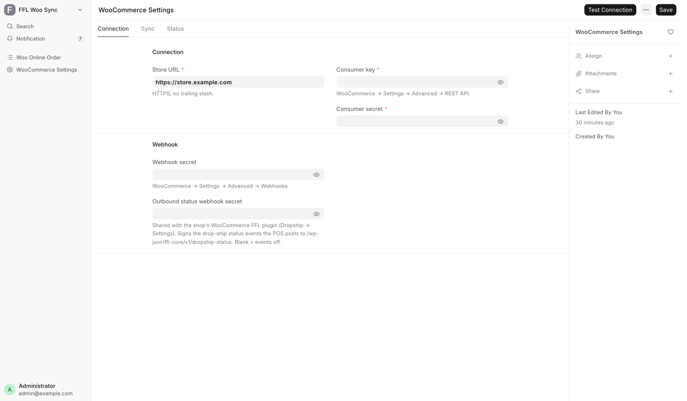
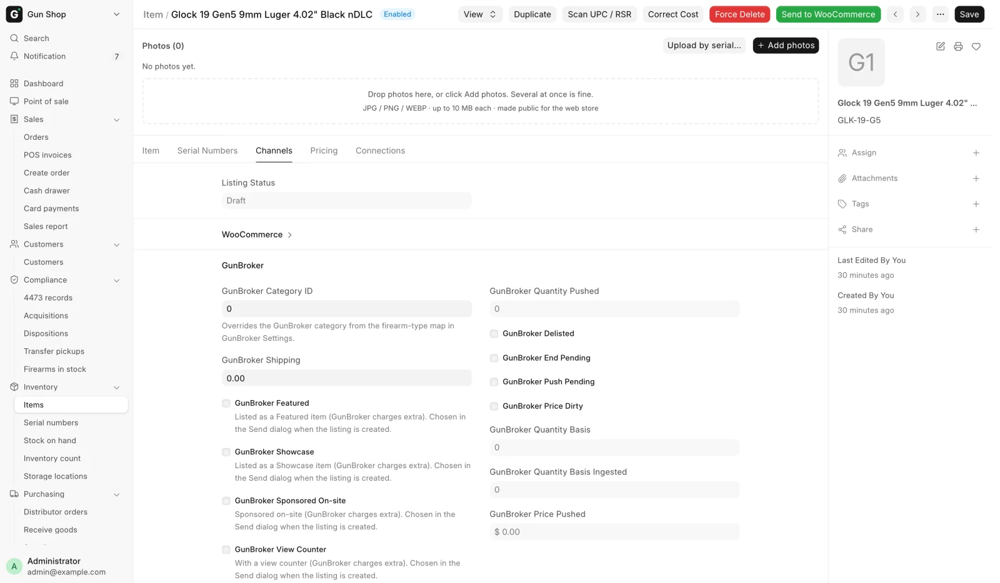

# WooCommerce web store

Inventory staff put stock on the web store from the POS. The buttons belong to Stock Manager and System Manager. You never build a product in WordPress. You press a button in the POS and the store receives the product it describes.

## Before you start

- **Enable sync** must be ticked on WooCommerce Settings. With it off the scheduled work stops: nothing is reconciled or audited. The buttons on the form still push.
- The record needs a price. A gun with no sell price and a model with no selling price are both refused.
- Photos belong on the record before you push. See [Photos](../inventory/photos.md).

<figure markdown>
{ .screenshot }
<figcaption>The Connection tab: the store address, the REST API pair, the webhook secret and the outbound status webhook secret. Enable sync, the category switch and the status fields sit on the two tabs beside it.</figcaption>
</figure>

The WooCommerce Settings form has three tabs. The Connection tab holds the store address, the REST API pair, the webhook secret and the outbound status webhook secret. Enable sync, the category switch and the reconcile frequency sit on the Sync tab. See [Integration settings](../settings/integrations.md#woocommerce-settings).

## A model, or one specific gun

The POS builds three shapes of web product, and the shape decides which form you work from.

| What you are listing | Where you press the button | What the store gets |
|---|---|---|
| Ammunition, optics, parts, anything not a firearm | Item form | One product, SKU is the item code, stock is the quantity on hand |
| A firearm Item with **Uniform Pricing** ticked | Item form | One product for the model, stock is the number of free guns |
| A firearm Item without Uniform Pricing | Serial No form, one gun at a time | One product per gun, SKU is `ITEM::SERIAL`, stock is 1 or 0 |

The Item form's **Send to WooCommerce** works out the shape for you. On a per-serial firearm it pushes every Active serial at once and reports how many went. The Serial No form is the only place to list or delist one physical gun.

The buttons appear on the Serial No form only for a per-serial firearm. On a uniform-priced firearm or a non-firearm they are hidden on purpose, because a per-gun product would double-count the model's stock.

Gun parts (uppers, barrels, triggers, lower parts and the like) are regular items, not firearms. They list by model like any accessory, carry no serial, and the website checkout does not ask the buyer for an FFL. A receiver or frame is a firearm and lists like one. See [Items and serial numbers](../inventory/items-and-serials.md).

## The two buttons

| Button | Where | Shown when | What it does |
|---|---|---|---|
| **Send to WooCommerce** | Item and Serial No | Item: always. Serial No: status is Active | Creates or updates the product on the store |
| **Delist from WooCommerce** | Item and Serial No | The record is on the store and not already delisted | Asks you to confirm, then sets the product to draft and stock 0 |

Delisting is not a deletion. The product stays in WordPress as a draft at stock 0, and the POS records the take-down so no automatic job puts it back. A delisted record shows an orange **Delisted from WooCommerce** indicator at the top of the form. Only a person pressing **Send to WooCommerce** again puts that record back on sale.

## What the store pulls

<figure markdown>
{ .screenshot }
<figcaption>The Item form's Channels tab. The WooCommerce section, collapsed here, records the product id, the listed flag, the last sync and the last error.</figcaption>
</figure>

The Item form's Channels tab has a collapsed WooCommerce section. It records the product id, the listed flag, the last sync and the last error.

| On the store | Comes from |
|---|---|
| Product title | Item Name. A per-serial gun uses the Serial No's own item name |
| Description | Item description. A per-serial gun uses its own description when it has one |
| Regular price | Selling Price on the Item, or Sell Price on the Serial No |
| Sale price and dates | Sale Price with its from and to dates |
| Photos | Gallery rows in order, then the single image field |
| Stock quantity | Calculated by the POS, see below |
| GTIN field | UPC |
| Caliber, Condition, Manufacturer, Model | The matching fields, as store attributes |
| Category | The shared category list, see below |
| MAP | **MAP** on the Item, see below |

Photos resolve in one order for a gun: the serial's gallery, then the serial's single image, then the Item's gallery, then the Item's image. Private uploads are made public as part of the push, because the store fetches them anonymously.

**MAP.** When the Item has a **MAP**, the store gets the figure so the storefront can keep the shown price from going below it. A used gun carries no MAP.

!!! note
    After a product has been published once, staff edits made in WordPress to the title, description, images, attributes or categories are protected. Automatic jobs only ever rewrite price, sale price, stock, the product's published or draft state, and the machine-written fields such as MAP. A change you make to POS content reaches the store when you press **Send to WooCommerce** by hand.

## Categories follow the shared list

The POS and the website use one category list. Each Item files under a node of that list: its **Catalog Category** for a distributor catalog product, otherwise its Item Group. The web store's category for the product is that node's category on the store.

- A category is created on the website only once it has a product for sale. Until then its products show under the nearest category above it.
- When a new category appears, the products already on the website that belong in it move into it by themselves. Only the category changes. Titles, descriptions and photos are left alone, and categories outside the shared list (a Clearance category, say) are kept.
- A push never creates a category. It files the product under the category that already exists.

The switch is **Follow the catalog category tree** on the Sync tab of WooCommerce Settings, on by default. Turned off, the category job skips the store and pushes leave product categories as they are. A manager can preview what the category job would change under the Categories tab of Data Service Settings. See [Integration settings](../settings/integrations.md).

## How stock is kept in step

The POS owns the number, and it is not a raw warehouse count.

- **Non-firearm**: everything in the bins, less anything parked in customer custody, less units already sold on a web order that has not shipped.
- **Uniform-priced firearm**: Active serials that no web order holds, less any pending web order that owes a unit without naming a gun.
- **Per-serial firearm**: 1 when the gun is Active and free. 0 when it is reserved by a web order, held by another sales channel, no longer Active, or already archived as sold.

Stock is pushed automatically when stock moves. Submitting or cancelling a counter invoice, a stock ledger movement, and a change to a watched field all enqueue an update. When many products change at once, the update goes to the store in one request. A gun that a marketplace has sold is sent to draft as well as stock 0, because it has not been sold on this store and might come back.

Units a web customer has paid for and that sit on the shelf waiting to ship are held from the register. Ringing one is refused with "Held for a web order" unless a Sales Manager rings it, and then the invoice notes it. See [Point of Sale](../selling/pos.md).

## When a gun sells

A gun sold at the counter or on the web store keeps its product page. The page stays published at stock 0 and gains the store's sold marking, so the URL keeps working and keeps its search ranking. A counter sale takes the gun off sale on the website right away. The realized price is written only when the sale came through a web order, which is the one path that carries an exact line total.

Two cases end differently:

- A gun removed for any reason other than a sale is drafted, not archived.
- A gun that somebody already took off the store by hand stays down. The system will not republish it as a sold page.

If the gun comes back, through a return or an undone disposition, the next push clears the sold marking and puts it back on sale.

## The reconcile job

Every two hours a job checks whether the store is due a reconcile and, if it is, compares the store against the POS and repairs what has drifted. It runs only when three things hold: **Enable sync** ticked, **Reconcile frequency** not set to Disabled, and enough time elapsed since the last run. The frequency choices are Every 2 Hours, Daily, Weekly and Disabled.

The job walks three passes.

1. Item-level products. Compares stock, regular price and the sale price with its dates, and pushes what differs. A product with no price is drafted.
2. Per-serial products on Active guns. Compares the stock figure, which is always 1 or 0.
3. Listed guns that are no longer Active, plus guns held by another channel or held as a customer transfer. These are taken down, and a sold gun gets its sold page.

Every push this job makes is limited to the POS-owned fields, so it can never overwrite content curated in WordPress.

## Checking the connection

The **Status** tab on WooCommerce Settings tells you whether the connection is working: when the POS last pushed, when the reconcile last completed, and what the last failure said in the store's own words. **Test Connection** on the toolbar reads one product back and changes nothing. See [Integration settings](../settings/integrations.md#woocommerce-settings) for the whole form.

## Troubleshooting

| Message you see | What it means | Fix |
|---|---|---|
| Not sent to WooCommerce: no sell price is set | The record would have listed at $0 | Set the price, then send it again. Any product already live is drafted at once |
| Not sent to WooCommerce: this product was taken off the store by hand | Somebody delisted this record deliberately | Open the Serial No and press **Send to WooCommerce** there |
| Not sent to WooCommerce: this is a customer's firearm held for an FFL transfer | The gun is not store property | Nothing to fix. It cannot be listed |
| Not sent to WooCommerce: this Item uses Uniform Pricing | You pressed the button on one serial of a model-level listing | List it from the Item form instead |
| Some guns were not sent | An Item-level push hit a guard on some serials | The message lists each serial and its reason. Fix those and send again |
| Not sent to WooCommerce (channel_reserved) | Another sales channel already sold this gun | Check [GunBroker](gunbroker.md). The gun is spoken for |
| A product shows in the wrong website category | The Item's category node is not on the store yet, or the switch is off | Check **Follow the catalog category tree**, then ask a manager to preview Categories |

For web orders arriving from the store, see [Web orders](web-orders.md).
