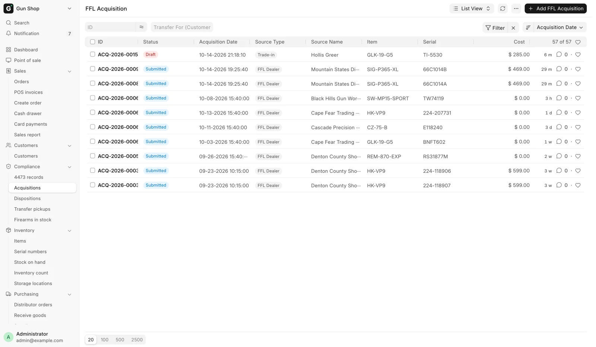
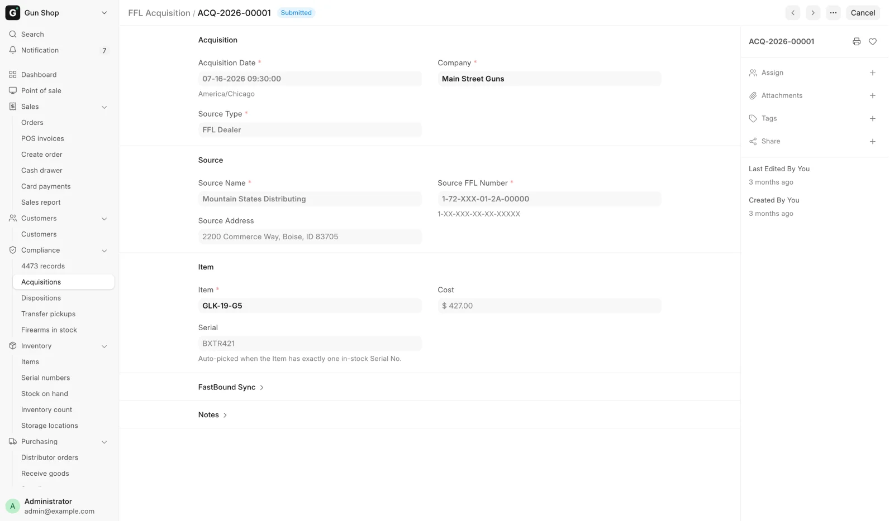
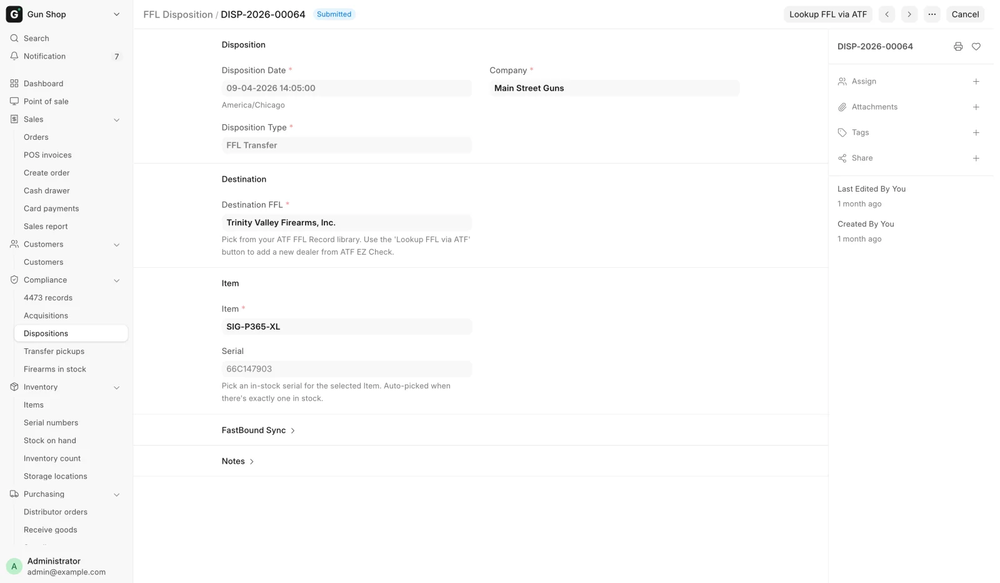
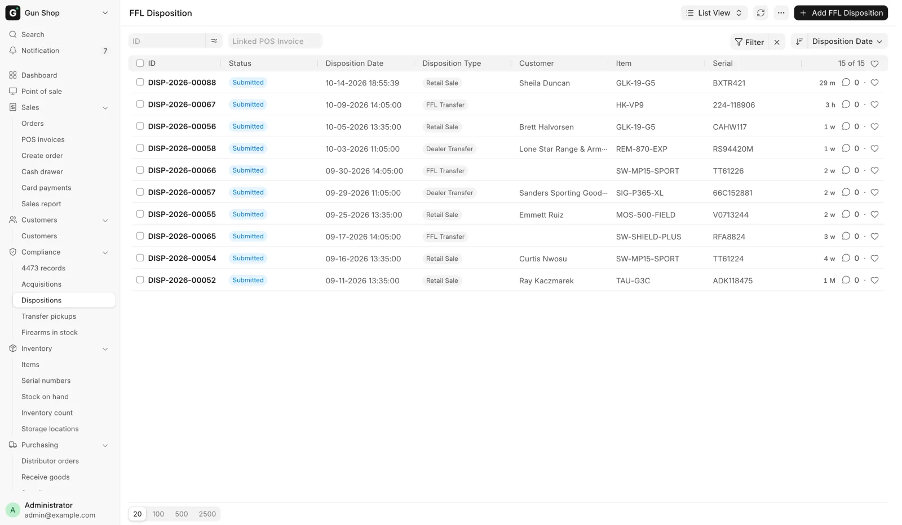

# The bound book

Two record types hold the acquisition and disposition book: **FFL Acquisition**
for a gun coming in, **FFL Disposition** for a gun going out. Both are created
for you by the pages you already use. A third record sits beside them: the
[4473 record](4473-records.md), one per completed Form 4473, which is kept even
when the order it ran on is deleted.

## You do not normally create these by hand

Every routine path writes them.

**Acquisitions:**

- [Receive Goods](../inventory/receive-goods.md) writes one FFL Acquisition per
  firearm serial when the Purchase Receipt submits. That covers distributor
  orders, parcels ordered outside the POS that you receive from **Incoming
  shipments**, and a gun bought from a private seller.
- [Trade-ins](../inventory/trade-ins.md) write one with source type
  `Trade-in`. A trade-in applied as credit is held as a draft and booked when
  the sale completes. A trade-in the store pays for on the spot is booked at
  once, on a receipt from the seller dated today.

**Dispositions:**

- The register writes the disposition for a retail sale once the
  [4473](4473.md) is complete. That includes the $0 pickup ticket for a gun
  ordered to the store.
- The [Pending Order queue](../selling/pending-orders.md) and the shipping flows
  write the disposition for a dealer transfer or a web order. A gun shipped to a
  C&R (Type 03) collector from [Create Order](../selling/create-order.md) leaves
  as an `FFL Transfer`.

In the sidebar, open **Compliance → Acquisitions** or **Compliance →
Dispositions** to read them, search them and check a gun's history. A counter
account with the Sales User or Sales Manager role can read acquisitions.
Dispositions open for Stock User, Stock Manager and System Manager only.

Creating one by hand is for the rare case a routine path cannot reach, and the
forms refuse several shapes outright to keep that honest.

<figure markdown>
{ .screenshot }
<figcaption>Every gun the store has received. One row is one physical firearm.</figcaption>
</figure>

## FFL Acquisition

The A side. One record per physical gun received, named `ACQ-<year>-<number>`.

<figure markdown>
{ .screenshot }
<figcaption>One acquisition: when the gun arrived, who it came from, and which serial it names.</figcaption>
</figure>

### Acquisition

| Field | Notes |
|---|---|
| **Acquisition Date** | Required. When the store took possession. |
| **Source Type** | Required. See below. |
| **Receive Source** | Your own procurement channel, carried from the Purchase Receipt. The list is managed under FFL Settings. |
| **Acquisition Type** | The FastBound acquisition type. The list is synced from your FastBound account. Blank falls back to a default derived from the source type. |
| **Company** | Required. |

**Source Type** options are `Individual`, `FFL Dealer`, `Manufacturer`,
`Importer`, `Estate`, `Pawn` and `Trade-in`. The choice drives what the form
demands next.

### Source

Who the gun came from. Which fields show depends on the source type.

| Field | Shown for |
|---|---|
| **Source Name** | Always. Required. |
| **Source First Name**, **Source Middle Name**, **Source Last Name**, **Source Suffix** | Individual, Trade-in, Estate, Pawn. FastBound records a private seller's name in parts. |
| **Source Address** | Always. |
| **Source FFL Number** | FFL Dealer only, and required there. Format `1-XX-XXX-XX-XX-XXXXX`. |
| **ID Type**, **ID Number** | Individual, Trade-in, Estate, Pawn. |
| **Seller (Customer)** | Individual, Trade-in, Estate, Pawn. Links to the customer record. |
| **ID Document** | Individual, Trade-in, Estate, Pawn. Stored privately. |
| **Transfer For (Customer)** | Always. Set when the gun arrived as a customer transfer-in. Drives the Pending Transfer Pickups report. |

The form refuses two shapes. A dealer source with no license number is rejected
under the title **FFL Required**: "Source FFL number is required when source type
is 'FFL Dealer'." A private-party source with no identification is rejected under
**ID Required**: "ID type and number are required for source type '<type>'."

### Item

**Item**, **Serial** and **Cost**. The serial is filled in automatically when the
item has exactly one in-stock serial.

### FastBound Sync

**FastBound ID**, **Last Synced** and **FastBound Sync Error** are read-only.
See [FastBound](fastbound.md) for what they mean and what to do when the error
field is not empty.

Submitting the record is what puts the gun in the book. Amending means cancelling
and creating a replacement that names the original.

## FFL Disposition

The D side. One record per gun leaving, named `DISP-<year>-<number>`.

<figure markdown>
{ .screenshot }
<figcaption>One disposition: the type, the destination FFL and the serial that left. The 4473 and NICS fields sit below on a retail sale.</figcaption>
</figure>

### Disposition Type

| Type | Used for |
|---|---|
| `Retail Sale` | A sale to an individual buyer with a 4473. Created by the register, not by hand. |
| `FFL Transfer` | Sending a gun to another licensee. |
| `Return` | Sending a gun back to where it came from. |
| `Scrap` | Destruction. Both witnesses are required. |
| `Gunsmithing` | Work by another licensee. |
| `Dealer Transfer` | A transfer to a dealer. |
| `NFA` | An NFA transfer. |

The dropdown is replaced by your FastBound account's own disposition list when
FastBound is reachable, so you may see types beyond these. Three are always
removed because they are not supported here: `Sale`, `Donation` and
`Private Party Transfer`. Picking one anyway is refused under
**Disposition Type Not Supported**, which says to handle that kind of transfer
directly in FastBound.

`Retail Sale` is hidden from the dropdown on a new record. It is created by the
4473 flow, and creating one by hand is refused under **4473 Handled by
FastBound**: "Retail Sale dispositions are created by FastBound after 4473 + NICS
completion — do not create them manually."

### Destination

**Customer** shows and is required for a Retail Sale. **Destination FFL** shows
and is required for `FFL Transfer`, `Dealer Transfer` and `Return`, and points at
a record in your ATF FFL Record library.

The **Lookup FFL via ATF** button appears on the toolbar for exactly those three
types. It opens **Lookup Destination FFL via ATF EZ Check**, takes an **FFL
Number** in the format `1-99-999-99-9X-99999` with hyphens optional, and on
**Lookup & Use** hits the live ATF check, caches the record locally and fills the
field. Next time that dealer is already in the dropdown. See
[Verifying an FFL](ffl-verification.md).

For `Scrap`, a **Destruction Witnesses** section appears and both **Witness 1**
and **Witness 2** are required.

### Item

**Item**, **Serial**, and optional links to the **Sales Invoice** and **Sales
Order**. Changing the item clears a serial that no longer belongs to it, so a
leftover value cannot dispose the wrong gun.

### Compliance

These fields show for a Retail Sale. The last two appear once the override is
ticked.

| Field | Options | Notes |
|---|---|---|
| **4473 Status** | `N/A`, `Pending`, `Completed` | Must be `Completed` to submit. |
| **NICS Status** | `N/A`, `Proceed`, `Delayed`, `Denied`, `Cancelled` | Must be `Proceed` to submit. |
| **Manual Override (4473 bypass)** | Checkbox | See below. |
| **Override Reason** | Free text | Required whenever the override is ticked. |
| **Override By** | Read-only | The user who asserted it. |

**Manual Override** marks a disposition somebody asserted rather than one
FastBound committed. Its description reads: "Set when a manager force-completed
the sale because FastBound was unavailable/diverged (the 4473 was completed in
FastBound but didn't sync back). Requires Sales Manager / System Manager + a
reason."

!!! warning "Federal recordkeeping"
    The override is not a second gate. A hand-asserted disposition satisfies the
    sale exactly like a FastBound-committed one, so the marking exists only for
    the people who read the book afterwards. Every one of them lands on the
    [Hand-Asserted 4473 Dispositions](daily-checks.md#3-hand-asserted-4473-dispositions)
    report, which a manager is expected to read back, and gets a
    [4473 record](4473-records.md) with Source `Paper / override` and no PDF.
    See [Form 4473 and NICS](4473.md).

Creating a manual-override disposition needs the Sales Manager or System Manager
role. The exception is when **Paper 4473 Mode** is on, where a counter role is
enough, because recording the paper form is then the store's ordinary way of
working.

## When the checks apply

Most checks run at submit, not at save, so a draft can be staged. That is
deliberate: it lets a manager stage a transfer and then look the receiving
dealer up with **Lookup FFL via ATF** before submitting.

| Message you see | What it means |
|---|---|
| `Serial number is required to submit a disposition.` | Pick the gun. |
| `Serial No <n> does not exist.` | Receive the gun first, or pick from the in-stock list. |
| `Serial No <n> belongs to Item <a>, not <b>.` | The serial and the item disagree. |
| `Retail Sale disposition requires 4473 status = 'Completed'.` | The form is not recorded yet. |
| `Retail Sale disposition requires NICS status = 'Proceed'.` | The check has not cleared. |
| `Destination FFL number is required for <type> disposition.` | Pick or look up the receiving dealer. |
| `<type> disposition requires both destruction witnesses` | Fill in Witness 1 and Witness 2. |
| `A manual-override disposition requires an Override Reason.` | Say why. |

<figure markdown>
{ .screenshot }
<figcaption>Every gun booked out, with the disposition type that took it out.</figcaption>
</figure>

## Antique firearms

A gun marked **Antique** on its item gets no acquisition and no disposition. It
is pre-1899 or otherwise exempt, so it never enters the bound book, nothing is
pushed to FastBound, and there is no 4473 or NICS check at sale. It is still
serialized stock and still shows on Firearms In Stock. See
[Receive Goods](../inventory/receive-goods.md).

The flag can only be set on an item with no guns in the bound book. Ticking
**Antique** on an item that already has a gun in stock with a bound-book entry
is refused under **Already in Bound Book**: "A gun in the bound book leaves only
via a disposition, not by flagging its Item antique."

If a record was booked by mistake for an antique, FastBound refuses it (it
never acquired that gun), and the record waits on the Dashboard's not-logged
list. A Stock Manager or System Manager who has checked it can mark it as not
belonging in the bound book. See
[FastBound](fastbound.md#a-record-that-does-not-belong-in-the-bound-book).

## Related pages

- [FastBound](fastbound.md) for the sync and its failure modes.
- [Form 4473 and NICS](4473.md) for how a retail sale's disposition is created.
- [4473 records](4473-records.md) for the permanent record of each completed form.
- [Verifying an FFL](ffl-verification.md) for the destination dealer library.
- [Daily checks](daily-checks.md).
