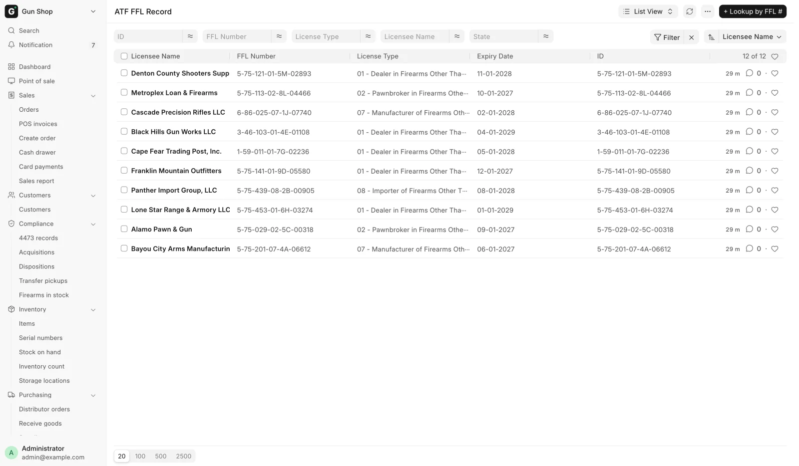
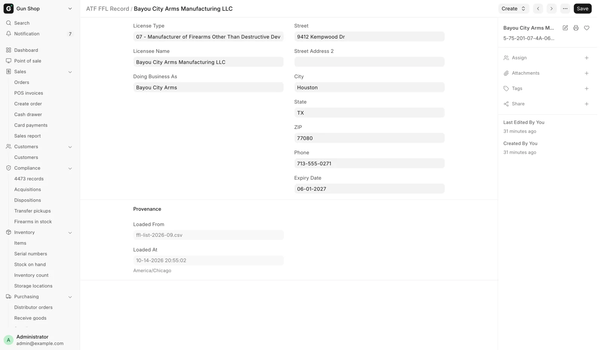
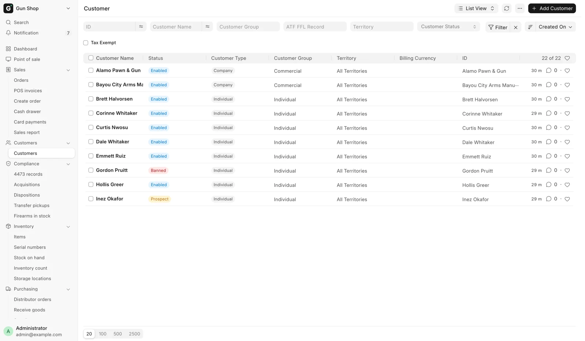
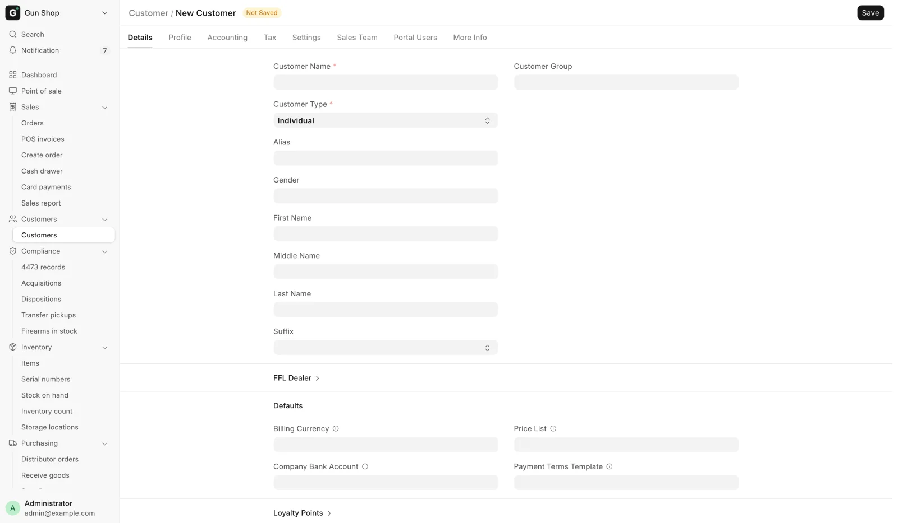

# Verifying an FFL

A firearm cannot be received from a dealer, or shipped to one, unless their
license is on file, verified and unexpired. This is how you get it there. A C&R
(Type 03) collector is the one exception to the live check, because the ATF
directory lists no collectors. See [C&R (Type 03) collectors](#cr-type-03-collectors).

<figure markdown>
{ .screenshot }
<figcaption>Every license the store has looked up, cached locally and searchable by number.</figcaption>
</figure>

## The ATF FFL Record library

Every license the store has looked up is cached locally as an **ATF FFL Record**.
The record is named by the FFL number itself, and carries **License Type**,
**Licensee Name**, **Doing Business As**, **Street**, **Street Address 2**,
**City**, **State**, **ZIP**, **Phone** and **Expiry Date**.

A **Provenance** section records where it came from: **Loaded From**,
**Loaded At** and **Live-Verified At**. A record loaded in bulk from the ATF's
published list has never been checked live, and its Live-Verified At is empty.

<figure markdown>
{ .screenshot }
<figcaption>One cached license. Provenance records where it was loaded from and when. Live-Verified At shows only once the record has been checked live.</figcaption>
</figure>

The library is the destination side of a transfer. A
[disposition](bound-book.md) picks its **Destination FFL** from here.

### Looking one up

From the ATF FFL Record list, the primary button is **+ Lookup by FFL #**, which
replaces the ordinary add button. It opens **Lookup FFL Record** and asks for an
**FFL Number**, described as: "Format: 1-99-999-99-9X-99999. Hyphens are
optional. The lookup hits ATF EZ Check live and caches the result here."

Click **Lookup & Save**. On success the record is saved and a message names it
and the licensee, in green when the status is Verified and orange otherwise.

The same lookup appears in two other places:

- **Lookup FFL via ATF** on an [FFL Disposition](bound-book.md), for a transfer
  destination.
- A **FFL Dealer? Lookup by FFL #** panel inside the quick-add dialog for a new
  Supplier, which fills the whole supplier form from the license.

### Creating a party from a record

An ATF FFL Record on its own is a directory entry, not somebody you can trade
with. Two buttons under **Create** turn it into one:

- **Create Dealer Customer**, for a dealer you ship guns to.
- **Create Supplier**, for a dealer you buy guns from.

Either creates the party already marked as an FFL dealer, already carrying the
license number and already linked back to the record, then opens it. If a party
already carries that FFL number the button opens that one instead and says so:
"<type> <name> already carries this FFL — opening it."

A dealer customer is also created for you when you pick **Business (FFL)** as
the buyer on [Create Order](../selling/create-order.md) and enter their license.

<figure markdown>
{ .screenshot }
<figcaption>The Customer list. Its own ATF FFL Record box filters it down to the dealers created from a license. A Banned, Inactive or Prospect customer carries a colored status.</figcaption>
</figure>

## Search ATF and Verify FFL

Both the Customer form and the Supplier form carry an **FFL** button group. It
appears only when **Is FFL Dealer** is ticked, so tick it and save first.

<figure markdown>
{ .screenshot }
<figcaption>A new Customer, before Is FFL Dealer is ticked. Tick it inside the FFL Dealer section and save, and the FFL button group appears on the toolbar. The Profile tab is covered on Customers.</figcaption>
</figure>

### Search ATF

Use this when you know the dealer's name but not their number, or you want to
pick from the directory rather than type a license in.

1. Click **Search ATF**. The dialog is titled **Search ATF FFL**.
2. Type into **FFL # or licensee name** and click **Search**.
3. Results list **FFL #**, **Licensee**, **City, State** and **Expiry**. Click
   **Pick** on the right row.

Picking fills in the FFL number, the license type, the licensee name, the
licensed premises address and the expiry date, and sets the verification status
to `Pending`. The message says what to do next: "Filled from ATF FFL Record.
Click Verify FFL to confirm against the live ATF."

When the provider is the Data Service, the search asks the service's national
listing first and adds any matching records from the local library. Those
national rows are shown but not saved until you pick one. If the service cannot
be reached, or the provider is anything else, the local library answers alone.

### Verify FFL

Use this to confirm a license against the live ATF check. It is the step that
turns `Pending` into `Verified`.

Click **Verify FFL** on the saved Customer or Supplier. It calls out to the
provider and stamps the result back onto the party: **EZ Check Status**,
**EZ Check Last Run**, the licensee name, the licensed address and the expiry
date. The message reads "FFL status: Verified" in green, "FFL status: Expired"
in orange, or "FFL status: Failed" in red.

**EZ Check Status** is one of `Pending`, `Verified`, `Failed` or `Expired`. A
lookup that finds nothing, and a provider that cannot be reached, both land on
`Failed`.

There is a third verify button, **Verify Our FFL**, on
[FFL Settings](../settings/ffl-settings.md). It checks the store's own license
and stamps nothing. Use it to test that the provider is working.

## Providers, rate limits and caching

The provider is set in FFL Settings under **FFL Verification → Live EZ Check**.

| **Provider** | What it does |
|---|---|
| `ATF Form Scraper` | The default. Queries the ATF's own eZ Check form directly. |
| `Data Service` | Routes through the shared Data Service, using the connection on [Data Service Settings](../settings/integrations.md#data-service-settings). The store and the web site share one cache and one polite request budget. It also returns a structured address. |
| `Manual Only` | Turns live verification off entirely. |

Two more fields sit beside it:

- **Rate Limit (req/hr)**, default 30, caps how often the ATF Form Scraper calls
  the ATF.
- **Cache TTL (minutes)**, default 1440, is how long a live result is reused
  before it is looked up again.

A cached record is only reused when it has actually been verified live and is
inside the TTL. A record loaded from the ATF's bulk list has never been verified
live, so it is never treated as fresh.

Every **Verify FFL** and every **Lookup by FFL #** forces a live call, skipping
the freshness check but still refreshing the cache.

If the provider is unavailable or the rate limit is hit, the system falls back to
the cached record rather than failing, and only raises an error when there is no
cached record at all. That means a number you have looked up before keeps
working through an ATF outage, and a brand-new number does not.

Choosing `Manual Only` makes every live lookup answer:
`EZ Check provider unavailable: Manual Only mode — live verification disabled.`

## The shipping rule

A firearm cannot leave the store to a dealer whose license is not verified and
unexpired. The check runs when the delivery note or the stock-moving invoice
submits, so it applies however the document was built.

The dealer's own record is checked in this order:

| Reason you see | What is wrong |
|---|---|
| `No FFL number on file.` | The customer is marked a dealer but carries no license number. |
| `FFL not verified (status: Pending).` | The license was filled in but never verified live. |
| `FFL not verified (status: Failed).` | The last verification failed. |
| `FFL expired <date>.` | The license has expired. |
| `FFL expired (no expiry on file).` | No expiry date is recorded, which counts as blocked. |

The refusal appears under the title **Dealer FFL Not Shippable**, or
**Destination FFL Expired** when the block is on an explicitly chosen
destination.

The rule is deliberately stricter than the receiving rule. Receiving accepts
`Pending`, so a clerk's first purchase from a newly created supplier is not
blocked. Shipping does not, because here the store is the one handing the gun
over.

Two more blocks apply to a destination chosen on an order:

- **Destination FFL Address Incomplete**, when the record has no street or no
  valid state. The message explains that the address is needed so sales tax is
  computed correctly.
- **Destination FFL Unresolved**, when a dealer customer's FFL number cannot be
  matched to any ATF record at all.

In every case the fix is the same. Open the dealer, run **Search ATF** if the
address is thin, then **Verify FFL**.

## C&R (Type 03) collectors

A collector with a Curio & Relic license holds a real FFL, so a C&R-eligible gun
can ship straight to their licensed premises. The ATF directory holds no Type 03
licenses, so **Verify FFL** and **Lookup by FFL #** can never find one. Staff
read the license copy instead.

On [Create Order](../selling/create-order.md), in **Destination FFL**:

1. Tick **C&R (Type 03) — ships to the collector's own license**. The lookup
   buttons give way to a form.
2. Type the **C&R License Number** as printed, in the form
   `1-99-888-03-7C-12345`. A collector who has ordered before fills in the rest
   from the record on file.
3. Type or check **License Expires**, **Collector Name**, **Licensed Premises
   Address**, **City**, **State** and **ZIP**, as they appear on the copy.
4. Click **Use this C&R license**. "C&R license saved — the order ships to the
   licensed premises."

The system saves an ATF FFL Record for the collector with a comment naming who
read the copy, and uses it as the order's destination. From then on it works as
any destination FFL: the ship-to is the licensed premises, sales tax follows
that address, and the gun leaves the bound book as an `FFL Transfer`. A web
order for a collector is checked against the same rules when it is disposed.
See [Web orders](../channels/web-orders.md).

| Message you see | What it means |
|---|---|
| `Missing C&R details: …` | A field on the form is blank. |
| `… is not a Type 03 (Curio & Relic) license — the fourth group must be 03…` | The number is not a collector's license. |
| `C&R license <n> expired on <date>.` | The license has expired. The gun cannot ship to it. |
| `"<value>" is not a valid US state.` | Fix the state. |

!!! warning "Federal recordkeeping"
    You are attesting that you read these details from the collector's license,
    and the record names you. Keep the copy with the order's records. The
    system does not check that the gun is a curio or relic. That judgment stays
    with the person shipping it.

## Troubleshooting

| Message you see | What it means | Fix |
|---|---|---|
| `'<value>' doesn't look like an FFL number. Expected format: 1-99-999-99-9X-99999` | The number is too short. | Retype it. Hyphens are optional. |
| `FFL number '<n>' not found in ATF EZ Check.` | The ATF has no such license. | Check the number with the dealer. |
| `EZ Check provider unavailable: Local rate limit exceeded` | Too many live lookups this hour. | Wait, or raise **Rate Limit (req/hr)**. |
| `EZ Check provider unavailable: Manual Only mode — live verification disabled.` | Live verification is switched off. | A manager changes **Provider** in FFL Settings. |
| `Data Service: shared EZ Check budget exhausted` | The shared service has hit its limit. | Wait, or switch **Provider** to `ATF Form Scraper`. |
| `Cannot receive firearm from supplier '<name>' — not registered as FFL Dealer.` | Receiving a gun from a non-dealer supplier. | Tick **Is FFL Dealer**, run **Search ATF**, then **Verify FFL**. |
| **Dealer FFL Not Shippable** | The receiving dealer's license is not usable. | Read the reason, then re-verify the dealer. |
| **Destination FFL Address Incomplete** | The record has no street or no valid state. | Open the ATF FFL Record and complete it, or re-verify. |
| **Destination FFL Unresolved** | The customer's FFL number matches no ATF record. | Run **Verify FFL** on the customer, or check the connection. |

## Related pages

- [The bound book](bound-book.md) for the transfer records this feeds.
- [Receive Goods](../inventory/receive-goods.md) for the receiving gate.
- [Transfers](../selling/transfers.md).
- [Customers](../selling/customers.md) for the rest of the customer record.
- [FFL Settings](../settings/ffl-settings.md) for the provider options.
