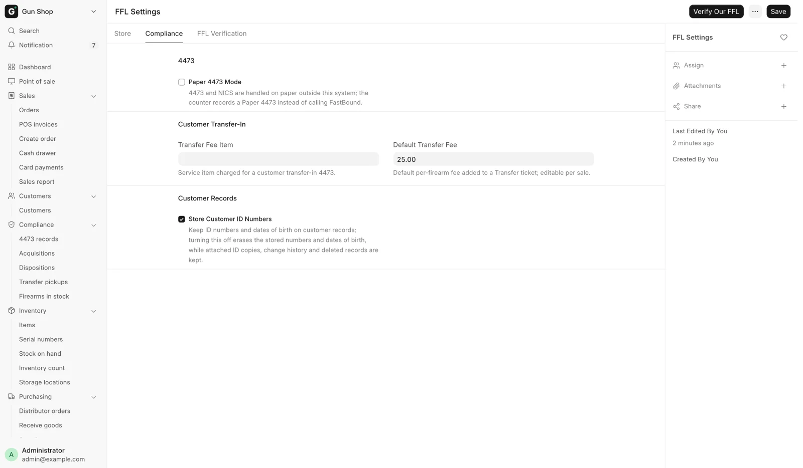

# Compliance

Everything the system records for ATF purposes, and the daily habits that keep
those records honest. Counter staff meet most of this at the register; a manager
owns the reviews.

## What the system records, and what it does not

The system keeps an acquisition and disposition record for every regulated
firearm that passes through the store. When a gun is received it writes an
[FFL Acquisition](bound-book.md) naming the date, the source and the serial, and
pushes it to the [FastBound](fastbound.md) bound book. When a gun leaves it
writes an [FFL Disposition](bound-book.md) naming where it went, and for a retail
sale it holds the sale until a completed [Form 4473](4473.md) and a NICS Proceed
are on record. Every completed 4473 also gets a permanent
[4473 record](4473-records.md), with a private copy of the signed form when
FastBound has one, and that record cannot be deleted.

It verifies a receiving dealer's license against the
[ATF directory](ffl-verification.md) before a firearm can ship, refuses a
firearm receipt from a supplier who is not registered as an FFL dealer, and stamps
every hand-asserted 4473 with who asserted it and why. Antique firearms are
tracked as serialized inventory and deliberately kept out of all of it.

None of that discharges the licensee's obligations. Completing and filing the
4473, running the background check, keeping the bound book accurate,
producing records on demand and knowing the law in your state remain the
licensee's responsibility. The system records what you tell it and stops you
completing certain steps out of order. It cannot verify that a form was actually
filled in or that a check actually cleared, which is why every hand-asserted
entry stores a name and a reason instead. Nothing on these pages is legal
advice.

!!! warning "Federal recordkeeping"
    Bound-book entries for a firearm you have taken possession of are due by the
    close of the next business day (27 CFR 478.125(e)). A trade-in applied as
    credit on a sale waits as a draft until that sale completes, and the draft
    is not in the book. The system emails a reminder when one is overdue. A
    trade-in the store pays for on the spot books at once. See
    [Trade-ins](../inventory/trade-ins.md).

## Where you see it

The [Dashboard](../getting-started/dashboard.md) is the morning view. Three of
its blocks are compliance: **Open 4473s** (background checks started, gun not
yet transferred), **Waiting on pickup** (customers' transfer guns) and **A&D**
(today's bound-book entries, and any record not in the bound book yet). The
[notifications bell](../getting-started/dashboard.md#notifications) rings for
each NICS result and for a record FastBound refused for good.

In the sidebar, the **Compliance** group holds **4473 records**,
**Acquisitions**, **Dispositions**, **Transfer pickups** and **Firearms in
stock**. A counter account with the Sales User role can open 4473 records,
Acquisitions and Transfer pickups. Dispositions and Firearms in stock open for
Stock User, Stock Manager and System Manager only.

## Pages

| I need to... | Go to |
|---|---|
| Understand what the acquisition and disposition records hold | [The bound book](bound-book.md) |
| Know how a 4473 gets recorded, on paper or electronically | [Form 4473 and NICS](4473.md) |
| Find a completed 4473 or open its signed PDF | [4473 records](4473-records.md) |
| Understand what syncs to FastBound, and fix a failed push | [FastBound](fastbound.md) |
| Clear a record that never belonged in the bound book | [FastBound](fastbound.md#a-record-that-does-not-belong-in-the-bound-book) |
| Verify a dealer's license before shipping or receiving | [Verifying an FFL](ffl-verification.md) |
| Know what to check every morning | [Daily checks](daily-checks.md) |
| See who overrode a 4473 gate and why | [Daily checks](daily-checks.md#3-hand-asserted-4473-dispositions) |
| Sell a firearm at the counter | [Selling a firearm](../selling/firearm-sale.md) |
| Run a customer transfer-in | [Transfers](../selling/transfers.md) |
| Change compliance settings | [FFL Settings](../settings/ffl-settings.md) |

<figure markdown>
{ .screenshot }
<figcaption>Compliance behavior starts here: Paper 4473 Mode, the customer transfer fee, and whether customer ID numbers are kept.</figcaption>
</figure>

