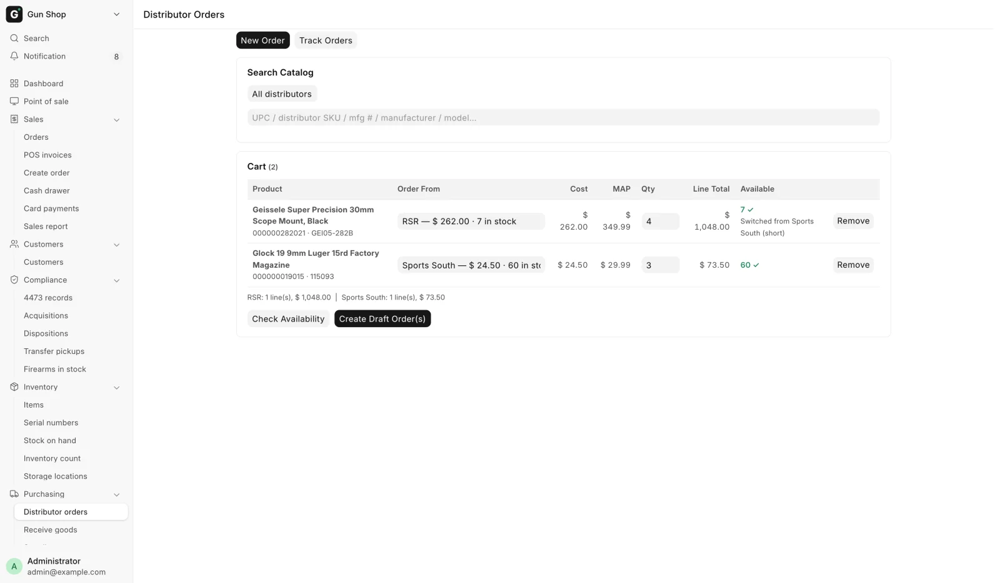
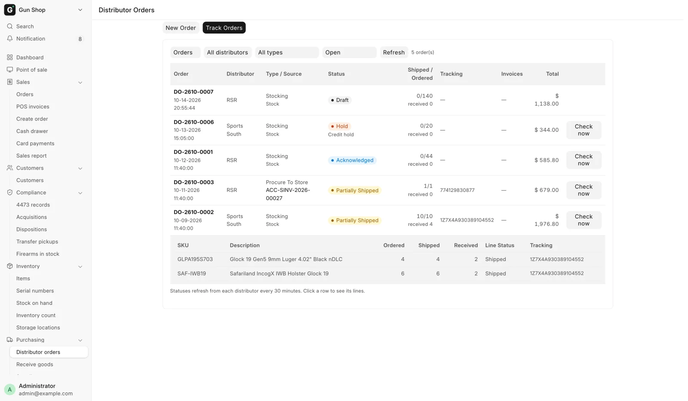
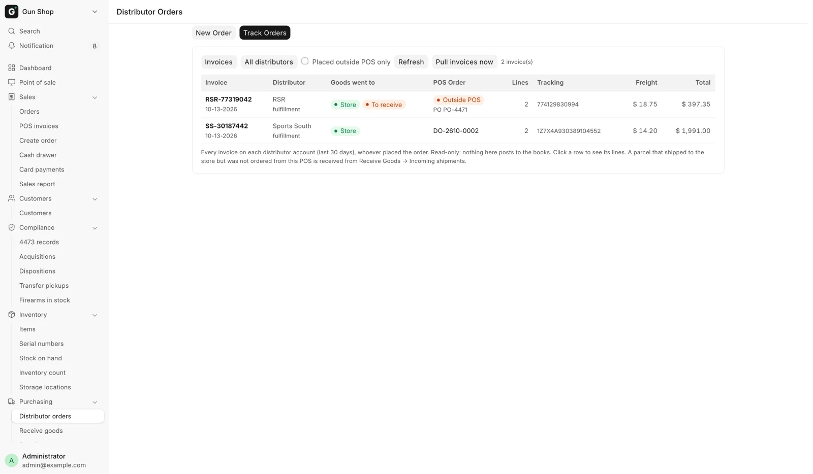

# Distributor orders

Buying stock for your own shelf, and keeping an eye on everything on its way
from a distributor. Purchasing staff search every house at once, build one cart,
and create draft orders. A person confirms each order before anything is
placed. When the goods arrive, they are received on Receive Goods or straight
from the order.

## Before you start

- A house needs **Enabled** and **Stocking** ticked on the
  [Distributors hub](hub.md) to take a stocking order.
- The page opens for System Manager, Purchase Manager, Purchase User and Stock
  Manager. The same roles create, confirm and cancel orders.
- Receiving from an order needs Stock Manager or System Manager.
- Nothing on this page places an order by itself. Every order waits in Draft.

## The Distributor Orders page

Open Sidebar → Purchasing → **Distributor orders**, or go to
**/app/distributor-restock**. The page has two tabs: **New Order** for buying,
and **Track Orders** for everything already ordered.

## New Order

<figure markdown>
{ .screenshot }
<figcaption>One search across every enabled house. Each cart line shows the house it will be ordered from.</figcaption>
</figure>

The tab runs down the screen: **Search Catalog**, then **Cart**. A third
section, **Created Orders**, appears once you have made some.

### Steps

1. **Type into Search Catalog.** It searches every enabled house on UPC,
   distributor SKU, manufacturer number, manufacturer and model. Results appear
   after two characters. To search one house only, pick it in the box above the
   search, which starts on **All distributors**.
2. **Read the row.** Each result shows a thumbnail, the name, an **FFL** tag when
   the item needs a license, and the UPC. The **Distributor · Cost · Qty** column
   lists every house that carries it, with its cost and how many it holds. The
   cheapest house that can fill one unit is in bold. **MAP** and **MSRP**
   follow.
3. **Set Order Qty and press Add.** The line joins the cart. Adding the same
   product again increases the quantity already there.
4. **Check the house on each cart line.** **Order From** starts on the cheapest
   house that holds enough for the quantity. Pick another house in the box to
   override it. Each choice shows that house's cost and stock.
5. **Press Check Availability.** The system asks every house on the cart for
   live quantities and costs. **Available** shows the live count with a ✓ or a
   ✗. A line whose house is short moves to a house that can fill it, and reads
   "Switched from _House_ (short)". You can switch it back. A line no house can
   fill stays where it was, marked ✗. This is a check, not a reservation.
6. **Press Create Draft Order(s).** The cart is grouped by house and the orders
   are made. Created Orders lists each one.
7. **Press Confirm & Queue on each order**, or **Confirm & Queue All**. That is
   the human gate. See [Confirm and queue](#confirm-and-queue).

Under the cart, a totals line gives the line count and cost per house. MAP and
MSRP are shown for judgement only. Nothing on this page clamps a price to MAP.

### How the cart gets split

**Create Draft Order(s)** makes at least one order per house, and splits further
where it must:

- Firearms and accessories never travel on the same order.
- A cart over 400 SKUs is chunked into several orders.
- Different lanes use different accounts at the house, so they are separate
  orders.

Orders made here are **Stocking** orders. Created Orders lists each one with
**Order**, **Distributor**, **Type**, **Account** and **Lines**. Click the order
name to open it. If one house refuses, its lines stay in the cart so you can fix
them and try again.

## Track Orders

**Track Orders** has two views, picked in the first box: **Orders** and
**Invoices**. **Refresh** reads the view again.

### Orders

<figure markdown>
{ .screenshot }
<figcaption>Every open distributor order, whatever it is for, with what has shipped and arrived.</figcaption>
</figure>

Every distributor order is here: stocking orders and ship-to-store orders for a
customer. Filter by house, by type, and by status. The
status box starts on **Open**.

| Column | What it shows |
|---|---|
| **Order** | The order number, and when it was placed |
| **Distributor** | The house |
| **Type / Source** | The order type, and the sale it is for. **Stock** when it is for the shelf |
| **Status** | Where the order is. A held order shows the house's hold reason, and an order in Error its error |
| **Shipped / Ordered** | Units the house has invoiced against units ordered, and how many were received here |
| **Tracking** | Every tracking number the house has reported |
| **Invoices** | The house's invoice numbers |
| **Total** | The order's cost |

Click a row to see its lines: **SKU**, **Description**, **Ordered**,
**Shipped**, **Received**, **Line Status** and **Tracking**.

Statuses refresh from each house every 30 minutes. A Stock Manager or System
Manager can press **Check now** on a live order to ask the house at once.

Below the orders, **Placed outside POS, not invoiced yet** lists orders on a
house's account that were placed somewhere else, such as the distributor's own
website or a phone call. Only a house that can list its orders appears here
(Sports South today). The table hides while you filter by type or by a single
status.

### Invoices

<figure markdown>
{ .screenshot }
<figcaption>Every invoice on each distributor account, matched to a POS order or marked Outside POS.</figcaption>
</figure>

Every invoice on each distributor account from the last 30 days, whoever placed
the order. The invoices are pulled from each house every hour. **Pull invoices
now** asks at once. The pull runs in the background, so press **Refresh** a
minute later. Tick **Placed outside POS only** to see only the ones no POS
order matches.

| Column | What it shows |
|---|---|
| **Invoice** | The house's invoice number and date |
| **Distributor** | The house, and the account it was billed on |
| **Goods went to** | **Store** or **Unknown** |
| **POS Order** | The matching distributor order, or an **Outside POS** pill |
| **Lines**, **Tracking**, **Freight**, **Total** | As billed. Fees show under the freight |

Click a row to see its lines, including the serial numbers the house shipped.

For a parcel that went to the store with no POS order behind it, **Goods went
to** also says whether it was received here: **Received** or **To receive**.
Receive it from Receive Goods → **Incoming shipments**, with **Receive this
parcel**. See
[Receive Goods](../inventory/receive-goods.md).
An invoice marked "Likely POS order _DO-…_ — awaiting link" is for the same
products as an open POS order. The status poll links the two. Receive the order.

The Invoices view is read-only. Nothing here posts to the books.

## The Distributor Order form

The order record carries the house, the order type, the account, the lines, the
addresses, and everything the house has echoed back: invoice numbers, tracking
numbers and serial numbers. It is not a submittable document. It walks a status
field instead. Open it from Track Orders, from Created Orders, or from the
Distributor Order list.

| Field | What it shows |
|---|---|
| **Distributor**, **Order Type** | The house and the lane: **Stocking** or **Procure To Store** |
| **Account** | The account at the house this order is placed on, as the distributor knows it |
| **Distributor Order No.** | The house's own number for the order. Status polls and holds are keyed by it |
| **Fill or Kill** | RSR orders only. Ticked, a line RSR cannot fill is dropped instead of back-ordered. Decided when the order is placed |
| **Shipping service** | The carrier service sent to the house, where the house offers a choice |
| **Delivery options chosen at the counter**, **Signature**, **Adult signature**, **Insurance** | Sports South orders only. The delivery options picked on Create Order |
| **Status**, **Hold / Cancel Reason** | Where the order is, and why it is held or was cancelled |
| **Receive Status** | **Not Received**, **Partial** or **Received** |

Each line carries the SKU, the quantities ordered, acknowledged, invoiced and
received, the invoiced unit cost, and the invoice numbers, tracking numbers and
serial numbers the house reported.

### The buttons

| Button | Shown when | What it does |
|---|---|---|
| **Confirm & Queue** | Status is Draft | Asks you to confirm, then moves the order to Queued and hands it to the placement worker |
| **Shipping service…** | Status is Draft, and the house offers a choice | Picks the carrier service. The amount is an estimate until the invoice replaces it |
| **Receive** | A Stocking or Procure To Store order has a line invoiced by the house and not yet received here | See [Receiving what arrives](#receiving-what-arrives) |
| **Check status now** | The order is live at the house | Pulls the invoice, tracking and serials now, instead of waiting for the half-hourly poll |
| **Cancel Order** | Status is not Complete or Cancelled | Asks for a reason and marks the order Cancelled |

**Cancel Order** sits under an **Actions** menu.

### Confirm and queue

Confirming is the moment the order becomes real. The dialog names the order and
asks "Confirm and queue ... for placement?" because placement is not reversible
on your side. The placement worker is idempotent, so a retry cannot place the
same order twice.

An order raised from a counter sale may be placed on a deposit, because the
goods land on your own shelf. The customer still pays the balance before taking
the goods.

!!! warning "Cancelling after placement"
    Cancelling an order that is live at the house sets the status to Cancelled
    here and does not withdraw anything at the house. The cancel dialog offers a
    tick reading **_House_ has confirmed the cancellation (phone / email)**.
    Leave it clear and operations are alerted to arrange the cancellation with
    the house. Tick it once the house has agreed, and no alert goes out.

### The status walk

| Status | What it means |
|---|---|
| **Draft** | Created and not yet confirmed. Nothing has been sent |
| **Queued** | Confirmed, waiting for the placement worker |
| **Placed** | The house has the order |
| **Acknowledged** | The house has accepted it and said what it will ship |
| **Hold** | The house is holding it. The hold reason is shown on the order |
| **Partially Shipped** | Some lines have shipped. More may follow |
| **Complete** | Finished |
| **Cancelled** | Ended without completing |
| **Error** | Placement failed. It may be queued again once the cause is fixed |

Live orders are polled every thirty minutes, backing off to every two hours per
order, with an alert once an order has sat unchanged for fourteen days. RSR
orders stay open until RSR has really shipped them, and the real tracking
number appears when it does.

When the house ships an order, the counter's
notification bell rings:
"_House_ shipped _DO-…_", or "_House_ shipped part of _DO-…_", followed by the
customer's name when the order is for one. The house gives no arrival date, so
the bell is the last word until the box arrives. The Dashboard's **Arriving**
card lists the orders not yet fully received.

## Receiving what arrives

Receiving is deliberately a staff action. Nothing is booked automatically,
because booking a firearm into the bound book is a compliance act.

**An order with a firearm on it** is received on Receive Goods. Press
**Receive** on the order, and Receive Goods opens with the order's lines
staged. Confirm each gun against the firearm in hand and scan its serial number
off the gun. The same orders are listed under Receive Goods → **Incoming
shipments**. See [Receive Goods](../inventory/receive-goods.md).

**An accessory-only order** can be received from the order itself:

1. Open the Distributor Order and press **Receive**.
2. Read the preview. It lists each item and the quantity in this batch.
3. Press **Submit Receive Goods**.

The receive books the stock. The Purchase Receipt name comes back in the
confirmation.

An order can arrive over several shipments. Each receive books only what has
been invoiced since the last one, and **Received Qty** on the line accumulates.
**Receive Status** on the order reads Not Received, Partial or Received.

!!! warning "A line with no cost"
    Every line received from an order needs a **Unit Cost** above zero. The
    refusal names the SKU, and you fix it on the order line from the house's
    invoice. A genuinely free line cannot be received this way. Use the Receive
    Goods page, where a zero cost is confirmed with a reason.

When the order was raised for a customer's sale, the guns you have now booked
are attached to that sale automatically, which clears it to be disposed.

## Troubleshooting

| Message you see | What it means | Fix |
|---|---|---|
| Cart is empty. | Nothing to order | Search and add lines first |
| Can't order from _House_: distributor _House_ is not enabled. | The house is switched off | Turn **Enabled** on in the hub, or order from another house |
| Can't order from _House_: ship to store is switched off for this distributor. | **Stocking** is off for the house | Turn **Stocking** on in the hub, or order from another house |
| SKU _X_: firearm receive needs _N_ serial number(s) from the distributor, got _M_. Receive it on the Receive Goods page and scan the serial off each gun. | The house did not send a serial for every gun | Receive on Receive Goods and scan each serial |
| No unit cost on _N_ line(s) of this order: … | A line has no **Unit Cost** | Enter it on the order line from the house's invoice, then receive again |
| Distributor _House_ has no Supplier set, so _DO-…_ cannot be received. … | The house's record names no supplier | A manager sets **Supplier** on the Distributor record |
| Nothing new to receive. | Everything invoiced has already been booked | No action. Check **Receive Status** on the order |
| Distributor order short-shipped: _DO-…_ (alert email) | The house shipped fewer units than you ordered | The cost invoice bills only what shipped. If the order was for a customer, deal with the short units by hand |
