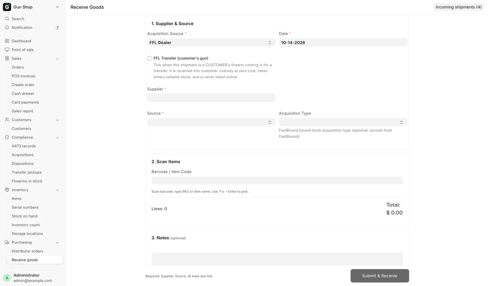
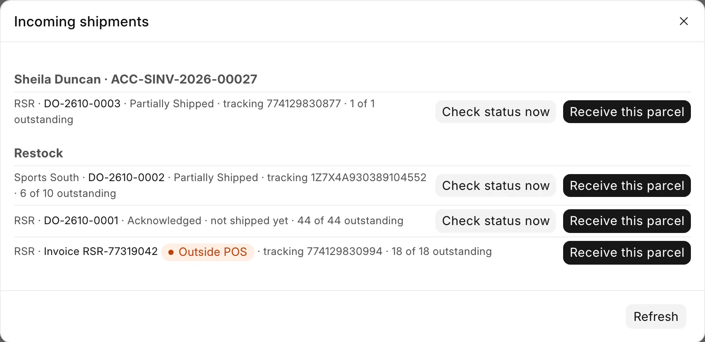
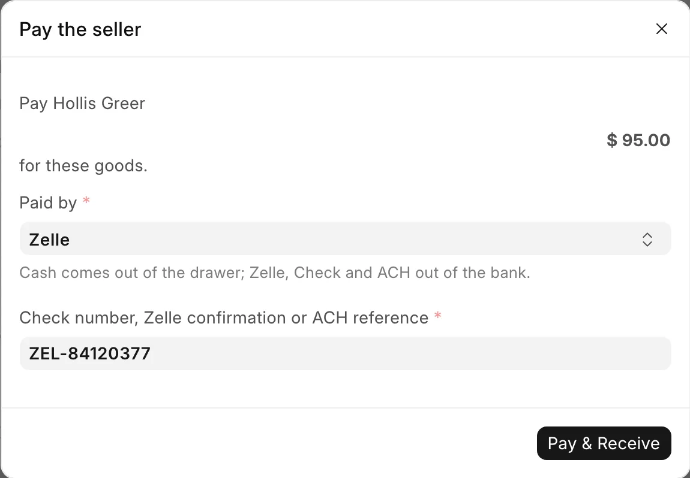
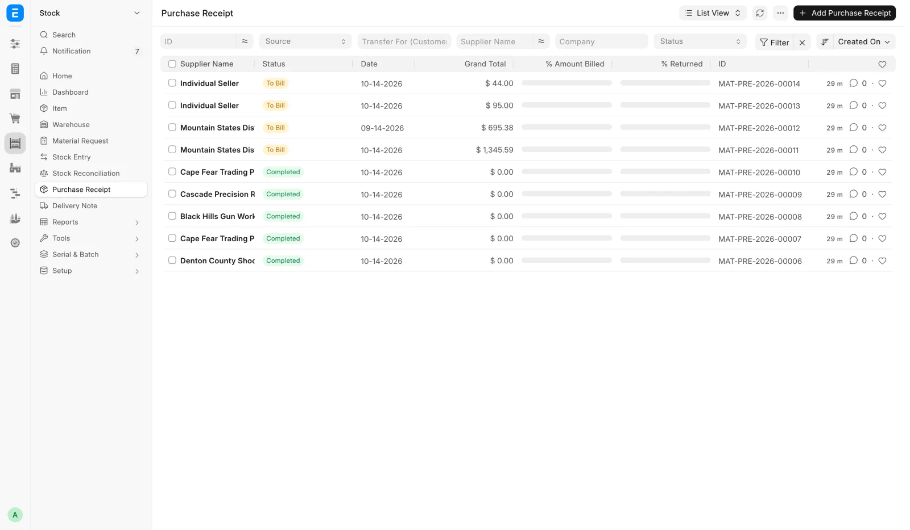
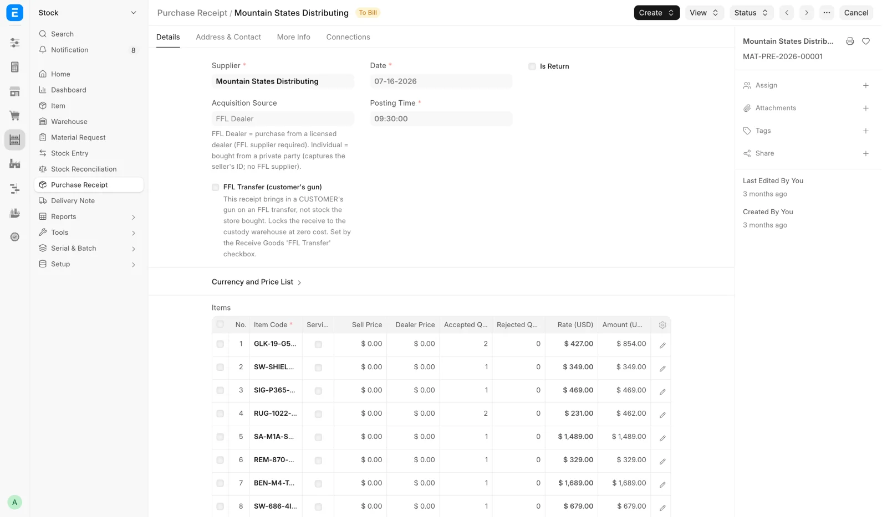

# Receive Goods

This is the single page for booking stock in: distributor shipments, guns bought from a private party and customers' guns arriving for a transfer. Open it from **Purchasing → Receive goods** in the sidebar, or use the **Receive goods** button on the [Dashboard](../getting-started/dashboard.md). The address is `/app/receive-goods`.

<figure markdown>
{ .screenshot }
<figcaption>Where the goods came from at the top, the scanner below it, and the running line count and total underneath. Submit & Receive stays in the footer.</figcaption>
</figure>

The page shows where the goods came from at the top, the scanner below it, and the running line count and total underneath. **Submit & Receive** stays in the footer.

## Before you start

- You need the **Stock Manager** or **System Manager** role to submit a receipt. The page also opens for **Stock User**, **Purchase User** and **Purchase Manager**, but **Submit & Receive** fails without one of the first two.
- For firearms from a dealer, the Supplier record must be marked as an FFL dealer with a license number on file. See [Verifying a dealer's license](../compliance/ffl-verification.md).
- Have the serial numbers in front of you. A firearm line cannot be added without one serial per unit.
- The **Source** list comes from FFL Settings. If the choice you want is missing, a manager adds it under [FFL Settings](../settings/ffl-settings.md).

## Distributor parcels: Incoming shipments

A parcel from a distributor is usually somebody's order: a customer's ship-to-store line from the counter, or a restock. The page knows about it before it arrives. **Incoming shipments (_n_)** at the top right opens the list. It shows one group per customer order, with each distributor order under it, its status, the distributor's tracking number (or "not shipped yet") and _n of m_ outstanding.

The list also shows parcels that were ordered **outside the POS**, on the distributor's website or by phone. Each one appears as **Invoice** and the invoice number, with an orange **Outside POS** pill. The POS learns about these from the distributor's invoices, so nobody types them in.

<figure markdown>
{ .screenshot }
<figcaption>A customer's distributor order with its tracking, and a parcel ordered outside the POS with its orange pill.</figcaption>
</figure>

There are four ways to work a parcel:

- **Scan first.** Scan the product's UPC in the scanner box. When an order is waiting for that item the page asks **Hold it for this order?** Press <kbd>Enter</kbd> for **Yes, hold for this order**, or choose **No — into store stock**. The answer is remembered for that item for the rest of the session, so ten magazines ask once. For a gun, type or scan the serial off the firearm. The page checks it against the serials the distributor said it shipped, and moves the line to another order when the serial belongs to that order's invoice.
- **Receive this parcel** or **Receive whole order** in the Incoming shipments dialog stages the order's outstanding lines in the table. Accessories are staged at the quantity due. Guns are staged one row per unit, with the distributor's serial filled in where it reported one. A staged row is unconfirmed until you scan it or open and edit it. The sell price, antique answer and year made you type on a staged gun's card are kept when it is received.
- **Receive this parcel** on an **Outside POS** invoice matches each invoice line to an item first ("Matching … to items…"), then stages the lines the same way. A line no item can be found or made for is listed under **Some lines could not be matched**. Scan those as plain stock.
- **Receive** on the Distributor Order form. An order with a firearm on it lands here with its lines staged and a note reading "… staged — scan each gun, check its details against the firearm, then Receive." An accessory-only order is received from the form in one step.

**Check status now** asks the distributor for its latest invoice, tracking and serials before you open the box. An Outside POS invoice has no such button. If the list cannot be refreshed, the dialog says "Could not load incoming orders. Showing the last known list — Refresh to retry."

!!! warning "Every gun is confirmed against the firearm in your hands"
    The distributor's catalog fills in manufacturer, model, type and caliber, and its invoice fills in the serial when it sent one. The bound book records the gun, not the catalog row. Read each field against the firearm before you receive. If a distributor reported no serial numbers, scan the serial off the gun.

Submitting books each distributor order's units on their own Purchase Receipt, against that order's supplier and invoiced cost, and holds them for the customer whose order they fill. Each Outside POS invoice also gets its own receipt. Store stock goes on its own receipt. No supplier has to be picked for order parcels.

You cannot receive more units than are still outstanding on an order or left on an invoice. The page refuses the extra and names the line. If you pick a distributor's supplier by hand while that distributor has parcels on the way, a warning lists them, so a customer's parcel is not booked as plain restock by mistake.

A barcode no item carries is looked up in the distributor catalogs. When it is found, the Create Item dialog opens pre-filled.

## Steps

### 1. Say where the goods came from

1. Set **Acquisition Source**. **FFL Dealer** is the default and covers every purchase from a licensed dealer or distributor. Choose **Individual** when the store is buying from a private party.
2. Check **Date**. It is prefilled with today.
3. For an FFL purchase, pick the **Supplier**.
4. For an individual purchase, fill in the seller block that appears. See [Buying from a private party](#buying-from-a-private-party).
5. Pick a **Source**. This is your own procurement channel, not an ATF field. A manager manages the list in FFL Settings.
6. Pick an **Acquisition Type** if you use one. This is the FastBound bound-book acquisition type, and the list is pulled from your FastBound account. If you leave it blank, the system falls back to a default derived from the source type. Choose `Consignment` when the gun belongs to someone who is leaving it with the store to sell. See [Selling guns on consignment](consignment.md).

### 2. Scan or search for the item

1. Click into **Barcode / Item Code** and scan. The page reads the Item Barcode table first, then the item code.
2. To find something without a barcode, type part of the SKU or the item name. The helper text under the box reads "Scan barcode, type SKU or item name. Use ↑↓ + Enter to pick." The dropdown also searches the distributor catalog and offers to create an item that does not exist yet.
3. Pick a result to open a card for that line.

### 3. Fill in the line card

Every line asks for **Qty**, **Cost** and **Sell Price**.

- **Cost** is what the store paid per unit. It is required. See [When a gun really was free](#when-a-gun-really-was-free) if it is genuinely zero.
- **Sell Price** is optional on a firearm. Staff often do not know the tag price at the counter, and a manager can set it later per gun on the Item form's **Serial Numbers** tab. On a non-firearm item, or on a firearm marked **Uniform Pricing**, whatever you type here becomes the item's selling price and reaches the register.

A firearm line asks for more:

| Field | Notes |
|---|---|
| **Serial Number(s)** | One serial per line of the box. The count must match Qty. |
| **Manufacturer** | Required. Picked from the Brand list. |
| **Model** | Required. |
| **Type** | Required. The ATF firearm-type vocabulary. |
| **Caliber** | Required. Picked from the Caliber list. |
| **Importer** | Only for imported guns. Starts blank on every receive. |
| **Antique (pre-1899 / GCA-exempt)** | See [Antique firearms](#antique-firearms). |
| **Year Made** | Appears only while Antique is ticked. Optional. |

Manufacturer, Model, Type and Caliber are prefilled from the distributor or the catalog where the system knows them. You confirm them here because they are what the bound book records. **Importer** is never prefilled. An import marking belongs to one physical gun, so you state it for the gun in front of you or leave it blank.

**Storage location** says where the goods go in the store. On a gun line the note reads "A slot holds one firearm. Several guns on one line fill the next free slots." and only free slots and open locations are offered. On any other line it reads "A display case, rack or safe." and only open locations are offered. The box is prefilled from the location you used last on this receipt, or the next free slot after it. Leave it blank if you are not sure. The goods then go on the [Not placed](storage-locations.md#the-not-placed-tab) list, where someone places them later. The field is hidden on a customer transfer.

Tick **Service needed (gunsmith / repair)** if the unit needs work before it can be sold. The flag lands on each Serial No and shows as a pill on the Item form's Serial Numbers tab, where the gunsmith clears it.

Click **Add to Receipt**. The line drops into the table and the scanner box takes focus again for the next item.

### 4. Review and submit

- The table shows Item, Qty, Cost and Subtotal, with a **FIREARM** mark and the serials under each gun line. An antique also carries an **ANTIQUE** mark, and a line with a location shows "Location:" and its name.
- Click any row to reopen it for editing, then **Save** or **Cancel**. Click **Remove** to drop the line.
- Add anything worth recording under **Notes**.
- The line above the button tells you what is still missing. When it reads "Ready to receive." the button unlocks.
- Click **Submit & Receive**. On a purchase from a private party the **Pay the seller** dialog opens first. See [Paying the seller](#paying-the-seller).

On success a green message lists each receipt: "Stock:" and the store-stock receipt (with "seller paid" and the amount when a seller was paid), "Invoice …" for an Outside POS parcel, and each distributor order with the customer it is held for. The page clears itself for the next shipment. If one of the receipts fails, **Some receives did not go through** names it, and its lines stay on the page so you can fix them and submit again.

## Buying from a private party

Set **Acquisition Source** to **Individual** and the Supplier picker is replaced by the seller block. Everything in it is required, because 27 CFR 478.125(e) requires the non-licensee transferor's name and address in the bound book.

| Field | Notes |
|---|---|
| **Seller (Customer)** | The private party's customer record. Picking one prefills the name and address fields below. |
| **Seller First Name** / **Seller Middle Name** / **Seller Last Name** / **Suffix** | Middle name is optional. FastBound records the names separately, so the page does too. |
| **Seller ID Type** | Driver License, State ID, Passport, Military ID, Other. |
| **Seller ID Number** | Required. |
| **Seller ID Document** | Optional photo or scan of the ID. Stored privately. |
| **Street Address**, **City**, **State**, **ZIP** | Required, as printed on the ID. The state must be the two-letter code and the ZIP a real ZIP. |

The Purchase Receipt is booked against a placeholder supplier named `Individual Seller`, which the system creates on first use. The real seller, their ID and their address live on the FFL Acquisition, which is where an auditor looks. The FFL-dealer checks are skipped on this path.

### Paying the seller

When the store buys from a private party, **Submit & Receive** first opens **Pay the seller**. It reads "Pay" with the seller's name and the amount, "for these goods." The amount covers every line on the receipt, the guns included.

<figure markdown>
{ .screenshot }
<figcaption>The seller payment is asked for before anything is received. Here Zelle is picked, so its confirmation number is required.</figcaption>
</figure>

1. Pick **Paid by**: Cash, Zelle, Check or ACH. Cash is preselected. The note reads "Cash comes out of the drawer; Zelle, Check and ACH out of the bank."
2. For Zelle, Check or ACH, type the **Check number, Zelle confirmation or ACH reference**. It is required.
3. Click **Pay & Receive**.

The payment is booked with the receipt, in the same step. Cash comes off what the [cash drawer](../selling/cash-drawer.md) should hold straight away. The dialog is skipped when nobody is paid at receipt: an **Acquisition Type** other than blank, `Purchase` or `Individual` (such as `Consignment`), a customer transfer, or lines that all cost $0.

A purchase from a private seller with no payment on record shows on the Cash Drawer page under "Purchases from private sellers with no seller payment recorded", where a manager records it. See [The cash drawer](../selling/cash-drawer.md).

!!! warning "Federal recordkeeping"
    An uploaded **Seller ID Document** is forced private on the way in. Do not attach a government ID to any other field, and do not put it in a photo gallery. Photo galleries are made public so the web store can read them.

## Customer transfers

Tick **FFL Transfer (customer's gun)** when the shipment is a customer's firearm arriving from another dealer for a transfer. A **Transfer for Customer** picker appears. Name the person who will collect the gun, so the Pending Transfer Pickups report (see [Daily checks](../compliance/daily-checks.md)) can age it.

Ticking the box changes the whole document:

- Every line is received into the customer-custody warehouse, not sellable stock.
- The **Cost** and **Sell Price** boxes are locked at zero. The store did not buy this gun, so it is worth nothing on the books and it is not for sale at any price.
- Only serialized firearms are allowed on the document. A customer's accessory is their property, and purchased goods belong on a separate receive.
- Each gun is flagged so no channel can list it online.

If you untick the box after adding lines, those lines become ordinary purchases at $0 and the page asks for a real cost before it will submit again.

Selling the transfer service itself happens at the register. See [Transfers](../selling/transfers.md).

## When a gun really was free

A cost of $0 that nobody confirmed cannot be told apart later from a cost nobody looked up, so the page asks. Leave **Cost** at zero and three controls appear:

1. Tick **Cost really was $0**. Tick it only when the store truly paid nothing, such as a supplier gift, a promotion or a warranty replacement. A cost nobody has looked up yet gets entered, not confirmed.
2. Pick a **Zero Cost Reason**: `Supplier gift`, `Promotional item`, `Warranty replacement`, `Sample` or `Other`.
3. Reason `Other` also requires one line under **What happened**, so a later stock-cost audit can read it instead of asking.

The confirmation, the reason and the note are stored on the receipt line and, for a firearm, on each Serial No. A customer transfer skips the question, because the cost is forced to zero.

## Antique firearms

**Antique (pre-1899 / GCA-exempt)** marks a gun that is still serialized inventory but is not a regulated firearm. It is tracked with a serial number and appears on Firearms In Stock. No bound-book acquisition is written, nothing is pushed to FastBound, and no Form 4473 or NICS check happens when it sells.

**Year Made** appears only while the box is ticked. It is optional provenance behind the exemption and never blocks the receive. An out-of-range year is dropped rather than rejected.

An item is antique or it is not, as a whole. Two lines of the same item with different Antique settings are refused. If the item already has guns in the bound book, the checkbox is disabled with the note "Already in the bound book — cannot be marked Antique (a booked gun leaves only via a disposition)."

## What the system does

Submitting is one transaction. Either everything below happens or nothing does.

1. **Creates and submits a Purchase Receipt.** Stock moves, and the receipt is the source document for the whole receive. Find it later in the Purchase Receipt list or on the Inventory Receipts report (see [Reports](../reports/index.md)).
2. **Writes the bound-book acquisition.** For each firearm serial that is not an antique, one submitted [FFL Acquisition](../compliance/bound-book.md) record is created. That is the A side of the book: date, source, item and serial.
3. **Stamps each Serial No.** Manufacturer, importer, model, caliber and year made land on the individual gun, along with the cost, the sell price, the service flag and any zero-cost confirmation. On a `Consignment` receipt it also records the consignor and the commission %.
4. **Updates the item.** Model, caliber and firearm type are kept current on the item because they define the model. Manufacturer seeds a blank item and never overwrites one. Importer is never written to the item.
5. **Applies the Sell Price.** On a non-firearm item, or a firearm with Uniform Pricing, the price you typed becomes the item's selling price and the register's price. A per-gun firearm stamps it on the serial instead. A customer transfer writes no price anywhere.
6. **Puts the goods in their locations.** Each line goes into the storage location you picked. A slot that someone filled a moment ago stops the whole receive instead of half-booking it.
7. **Pays the seller.** On a purchase from a private party, the payment you chose in **Pay the seller** is booked.
8. **Pushes to FastBound.** The push runs last, inside the same transaction. If FastBound rejects the firearm, the Purchase Receipt, the Serial No records, the stock movement, the locations, the seller payment and the acquisitions are all rolled back together, and you see the reason. The gun enters FastBound and your stock, or it enters neither.
9. **Fills the waiting order.** A gun received against a distributor order is hung on the order it was bought for, as that order's held serial. For a counter pickup with a shift open on the register, the $0 pickup ticket opens at the same time. See [Pickup tickets](../selling/pos.md).

<figure markdown>
{ .screenshot }
<figcaption>Past receives, filtered by Source or Transfer For (Customer). A private-party buy shows the Individual Seller placeholder.</figcaption>
</figure>

<figure markdown>
{ .screenshot }
<figcaption>The submitted receipt behind a receive. It is the source document for everything else.</figcaption>
</figure>

If a manager cancels a receipt that paid a private seller, the seller payment stays recorded, because the money already left. Amending the receipt carries the payment over. If the seller gave the money back, undo the payment on the [Cash Drawer](../selling/cash-drawer.md) page.

## The FFL gate

A firearm line cannot be received from a supplier who is not a verified FFL dealer. The check runs on the Purchase Receipt itself, so it applies however the receipt was built.

If the supplier is not marked as a dealer you see:

```
Cannot receive firearm from supplier '<name>' — not registered as FFL Dealer.
Open the Supplier form and use 'Search ATF' to populate FFL information.
```

Open the Supplier, tick **Is FFL Dealer**, use **Search ATF** to fill the license details from the ATF directory, then **Verify FFL** to confirm against the live check. See [Verifying a dealer's license](../compliance/ffl-verification.md).

A status of `Pending` is accepted at receiving time, so a clerk's first receipt from a newly created supplier is not blocked. `Failed` and `Expired` are not accepted.

## Troubleshooting

| Message you see | What it means | Fix |
|---|---|---|
| `Cannot receive firearm from supplier '<name>' — not registered as FFL Dealer.` | The supplier has no FFL on file. | Open the Supplier, use **Search ATF**, then **Verify FFL**. |
| `Supplier '<name>' is marked as FFL Dealer but has no FFL Number on file.` | The dealer checkbox is ticked but the license number is blank. | Fill in the FFL Number, or run **Search ATF** again. |
| `Supplier '<name>' EZ Check status is '<status>'. Re-verify the FFL before receiving firearms.` | The last verification failed or the license expired. | Run **Verify FFL** on the Supplier. |
| `Need N serial(s), got M.` | The serial box does not match Qty. | One serial per line, no blank lines. |
| `Firearm details required: ...` | Manufacturer, Model, Type or Caliber is blank. | Fill in the named fields on the card. |
| `Row #N: cost of $0 for <serial> needs confirming.` | A zero cost with no confirmation. | Enter the real cost, or tick **Cost really was $0** and pick a reason. |
| `Row #N: <serial> is marked as $0 but carries a cost of <amount>.` | The free tick and a price contradict each other. | Clear the cost, or untick **Cost really was $0**. |
| `Row #N: '<item>' is not a serialized firearm, so it cannot be received on an FFL Transfer.` | A non-gun line on a transfer document. | Split the document. Purchased goods get their own receive. |
| `Item '<code>' appears on multiple lines with conflicting Antique settings` | The same item is on two lines, one ticked antique and one not. | Receive it under one classification. |
| FastBound rejected the receive and nothing was booked | The bound-book push failed, so the whole receive was undone. | Read the message, fix the firearm details or the supplier's FFL, and receive again. |
| `SKU …: firearm receive needs N serial number(s) from the distributor, got M.` | The Distributor Order form tried a one-step receive on a gun the distributor sent no serial for. | Receive it on this page: open **Incoming shipments**, stage the order, and scan the serial off each gun. |
| Could not load incoming orders. Showing the last known list — Refresh to retry. | The incoming list failed to refresh. | Click **Refresh** in the dialog. Do not treat the parcel as store stock on the strength of an empty list. |
| … has _N_ order(s) still on the way | You picked a distributor's supplier by hand while orders from that distributor are open. | If the parcel is one of them, open **Incoming shipments** and receive it there. |
| `<order> <SKU>: N unit(s) scanned but only M outstanding on this order.` | More units than the order still expects. | Receive the extra as plain stock, or check the count. |
| `Invoice <n> <SKU>: N unit(s) scanned but only M left to receive on it.` | More units than the invoice has left. | Check the count against the packing slip. |
| `Invoice <n> belongs to order <order> — receive it there.` | The parcel is a POS order's after all. | Receive it under that order in **Incoming shipments**. |
| `Invoice <n> looks like the parcel for open order <order> …` | An open order expects the same item. | Receive that order instead, or finish or cancel the order first. |
| `Invoice <n> has already been received.` | Someone booked this parcel already. | Nothing to do. Check the Purchase Receipt list. |
| `Distributor <name> has no Supplier set, so <order> cannot be received. …` | The Distributor record names no supplier to bill. | Ask a manager to set **Supplier** on the Distributor record. |
| `<location> already holds <serial>. A slot holds one firearm: …` | The slot was filled by another gun. | Pick a free slot, or leave the location blank. |
| `Enter the <method> reference.` | Zelle, Check or ACH was picked with no reference. | Type the check number or confirmation. |
| `Pick how the seller was paid.` | **Paid by** is blank. | Pick Cash, Zelle, Check or ACH. |
| `The seller would be paid <amount>, not the <amount> shown when you clicked Submit. Nothing was saved; …` | A line changed after the dialog opened. | Check the lines and submit again. |

## Related pages

- [Trade-ins](trade-ins.md) for taking a gun in against a sale.
- [Selling guns on consignment](consignment.md) for taking in a gun to sell for its owner.
- [Items and serials](items-and-serials.md) for pricing and describing what you received.
- [Corrections](corrections.md) if something went in wrong.
- [Storage locations and the store map](storage-locations.md) for placing goods after the receive.
- [Distributor orders](../distributors/restock.md) for ordering and tracking what is on the way.
- [The bound book](../compliance/bound-book.md) for what the acquisition record holds.
