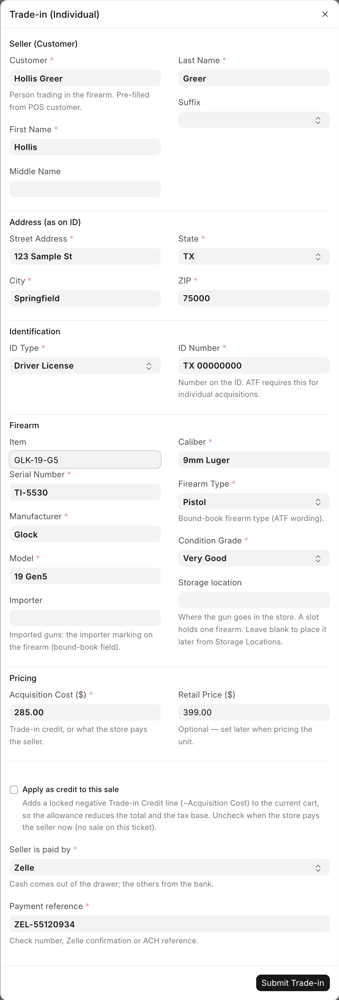
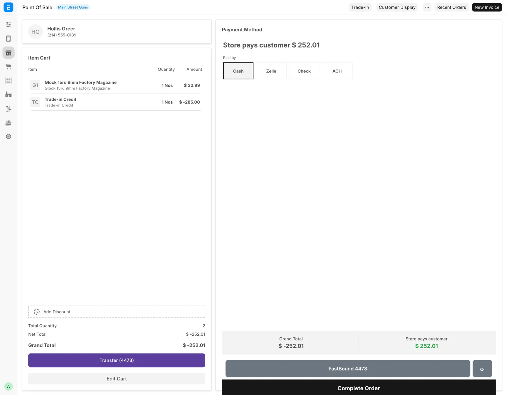

# Trade-ins

This page covers taking a customer's gun in part-exchange at the register, or buying it from them outright. The cashier runs it from the POS screen while the customer is at the counter.

## Before you start

- Trade-ins through this dialog are private-party purchases only. A gun coming from a dealer or a distributor goes through [Receive Goods](receive-goods.md).
- Counter staff with the **Sales User** role can take a trade-in, as can **Stock Manager** and **System Manager**. A shift lead who only has **Sales Manager** also needs **Sales User**.
- From the counter, file the gun under an existing used firearm item, or leave **Item** blank and one is made for this gun. Creating a new item is a stock manager's job.
- Select the POS customer first if you intend to apply the trade as credit. The cart refuses lines without a customer, and the dialog checks before it records anything.
- To pay the seller now instead, the seller must be a Customer record. Pick them in the dialog's **Customer** box.
- Have the seller's photo ID in hand. Their name and address as printed on it are required.

## Steps

1. On the POS screen, click **Trade-in**. The dialog is titled **Trade-in (Individual)**.
2. Under **Seller (Customer)**, confirm the **Customer**. It is prefilled from the POS customer, and picking one fills in the name and address below.
3. Check **First Name**, **Middle Name**, **Last Name** and **Suffix** against the ID. First and last name are required.
4. Under **Address (as on ID)**, fill in **Street Address**, **City**, **State** and **ZIP**. All four are required. State is the two-letter code.
5. Under **Identification**, pick the **ID Type** (Driver License, State ID, Passport, Military ID, Other) and type the **ID Number**.
6. Under **Firearm**, use the **Item** search to pick or create the model SKU this gun files under. The search covers your own items and the distributor catalog, and lets you create a new one such as `Glock19 USED`.
7. Fill in **Serial Number**, **Manufacturer**, **Model**, **Caliber**, **Firearm Type** and **Condition Grade**. All are required. **Importer** is optional and applies to imported guns only.
8. Pick a **Storage location** for the gun if you know where it goes. Only free slots and open locations are offered, because a slot holds one firearm. Leave it blank to place the gun later from [Storage locations](storage-locations.md).
9. Under **Pricing**, enter the **Acquisition Cost ($)**. This is the credit or the payment the seller is getting. **Retail Price ($)** is optional and can be set later.
10. Decide on **Apply as credit to this sale**, which is ticked by default. See below.
11. If you unticked it, pick **Seller is paid by** (Cash, Zelle, Check or ACH; Cash is the default). For anything but Cash, type the **Payment reference**: the check number, Zelle confirmation or ACH reference.
12. Click **Submit Trade-in**.

<figure markdown>
{ .screenshot }
<figcaption>Seller, ID and firearm details, the storage location, and the choice between a credit and paying the seller now.</figcaption>
</figure>

## Apply as credit, or pay the seller now

**Apply as credit to this sale** ticked is the ordinary counter case. The allowance comes off this ticket, reducing both the total and the tax base.

- A locked negative Trade-in Credit line for the acquisition cost is added to the live cart. The message reads "Trade-in recorded" with the credit amount.
- The line is fixed. Tapping it or changing its quantity or price is refused with "Trade-in credits come from the Trade-in button, and their amount is fixed. Remove the line to undo it." To change the amount, remove the line and run **Trade-in** again.
- A sale with a trade-in credit cannot take an invoice discount. Put any discount on the item line instead.
- The bound-book acquisition is parked as a **draft**. Nothing is booked, no stock is received and nothing reaches FastBound yet.
- The gun books when the sale completes. Submitting the POS Invoice creates the bound-book entry and receives the stock, and the record goes to FastBound right after.

Untick the box when the store buys the gun and pays the seller now, with no sale on this ticket. The gun is received on a Purchase Receipt from the seller, dated today, exactly as a private-party buy on Receive Goods would be, and the payment is booked with it. The message reads "Trade-in recorded · Item … · Receipt …. The payment to the seller is booked." A cash payment comes off what the [cash drawer](../selling/cash-drawer.md) should hold straight away. If the payment was recorded wrongly, a manager undoes it on the Cash Drawer page, not in the accounting screens.

Running the dialog again for a serial that already has a pending credit draft refreshes that draft with the new cost and seller details. It does not create a second record.

!!! warning "Federal recordkeeping"
    If the dialog reports **Credit Line Not Added**, do not complete the checkout. The trade-in was recorded but the credit is missing, so the buyer would be charged full price and the gun would never book. Reopen the item cart and run **Trade-in** again for the same serial. It reuses the pending record.

## Trade-ins worth more than the sale

When the trade-in credits come to more than what the customer is buying, the whole deal stays on one ticket and the store pays the customer the difference.

<figure markdown>
{ .screenshot }
<figcaption>The payment screen of a ticket the store pays out on. There is nothing to tender.</figcaption>
</figure>

1. Add the goods and run **Trade-in** with **Apply as credit to this sale** ticked, as usual.
2. Go to payment. Instead of the tender tiles, the screen shows **Store pays customer** and the amount. There is nothing to tender.
3. Under **Paid by**, pick Cash, Zelle, Check or ACH. Cash is picked already.
4. For anything but Cash, type the reference in the box marked "(required)": the check number or confirmation number.
5. Complete the order.

No sales tax is charged on that ticket: the tax line reads 0.00. The receipt shows Items sold, Trade-in allowance, the tax, the Total, and "Paid to customer" with the method and reference. A cash payout comes out of the drawer.

The store can pay the customer only for guns bought from a private person. If a card was already charged on the order, a manager has to void it first.

## What the system does

For a credit trade-in, once the sale submits:

1. **Creates or reuses an Item.** If you picked a model SKU, the gun files under it. If you did not, a used-firearm item is created for this gun.
2. **Submits the FFL Acquisition** with source type `Trade-in`, carrying the seller's name, address, ID type and ID number.
3. **Receives the gun into stock** as a Material Receipt at the acquisition cost, creating the Serial No record, and puts it in the storage location you picked.
4. **Pushes the acquisition to FastBound.**

For a pay-now buy, at once:

1. **Creates or reuses an Item**, as above.
2. **Creates a Purchase Receipt** from the `Individual Seller` placeholder, dated today, with the source `Trade-in`, and puts the gun in its storage location.
3. **Submits the FFL Acquisition** with source type `Trade-in` and the seller's details.
4. **Books the payment to the seller** from the drawer (Cash) or the bank (Zelle, Check, ACH).
5. **Pushes the acquisition to FastBound.** If FastBound refuses, nothing above is kept.

The condition grade you entered lands on the gun, so the Firearms In Stock report and the web listing describe it correctly. Barrel length, finish and year made are not on this dialog. Add them afterwards on the gun's own record.

## The next-business-day deadline

A draft acquisition is a gun the store has taken possession of that is not yet in the bound book. Under 27 CFR 478.125(e) the entry is due by the close of the next business day after taking possession, so the system watches for drafts that have been sitting. Only credit trade-ins leave drafts. A pay-now buy is booked at once.

An hourly job looks for draft acquisitions dated before today whose source type is Trade-in, Individual, Estate or Pawn, and emails a reminder titled:

```
[POS Alert] N trade-in draft(s) not yet in the bound book
```

The body names each draft, its serial and its seller, and states the three ways out:

> Bound-book entries are due by the close of the NEXT business day after taking possession (27 CFR 478.125(e)). For each draft below: complete the checkout, or submit the acquisition directly if the store keeps the gun, or delete the draft if the customer took it back.

The reminder is sent at most twice a day. It goes to the addresses in FFL Settings under **Alert Recipients**, or to every System Manager when that field is empty.

An abandoned cart is the usual cause. The customer changed their mind, the cashier moved on, and the draft stayed behind.

## Taking a trade-in through Receive Goods

Use [Receive Goods](receive-goods.md) with **Acquisition Source** set to **Individual** when the purchase is not tied to a sale at the counter. It suits a few guns bought at once, an estate purchase, or any private-party buy where nobody is standing at the register. It collects the same seller identity and address, adds an optional **Seller ID Document** upload, and asks how the seller was paid before it books.

The choice affects the source type recorded in the bound book. The POS dialog writes `Trade-in`, whether the gun is a credit or a pay-now buy. Receive Goods writes `Individual`.

## Troubleshooting

| Message you see | What it means | Fix |
|---|---|---|
| `Select the POS customer (the buyer) before applying a trade-in credit.` | No customer on the cart. | Pick the customer on the POS screen, then reopen the dialog. |
| **Credit Line Not Added** | The gun was recorded but the credit did not reach the cart. | Do not check out. Reopen the item cart and run **Trade-in** again for the same serial. |
| `Missing required fields: ...` | Something required is blank. | Fill in the named fields. |
| `Seller address is incomplete — missing: ...` | Part of the address is blank. | All four address fields are required. |
| `Seller address state must be the 2-letter code` | The state was typed in full. | Use `TX`, not `Texas`. |
| `Seller address ZIP '<value>' is not a valid ZIP code.` | The ZIP is malformed. | Five digits, or five plus four. |
| `Say how the seller was paid (Cash, Zelle, Check, ACH), or apply the trade-in as a credit to a sale.` | Credit is unticked and no payment method was picked. | Pick **Seller is paid by**, or tick the credit box. |
| `Pick the seller from Customers to pay them now.` | The seller is not a Customer record. | Pick or create the customer in **Customer**. |
| `Enter what the store pays the seller.` | A pay-now buy with a cost of $0. | Enter the **Acquisition Cost ($)**. |
| `Serial '<serial>' is already on file. Edit the existing item instead.` | This serial is already in the system. | Check the gun's Serial No record before buying it. |
| `Trade-in credits come from the Trade-in button, and their amount is fixed. …` | You tapped or edited the credit line. | Remove the line and run **Trade-in** again. |
| `This sale has a trade-in credit line, so it can't take an invoice discount …` | An invoice-level discount sits next to a credit. | Remove it and discount the item line instead. |
| `This sale's trade-ins come to more than what the customer buys … Set every payment amount to 0` | A payment was entered on a payout ticket. | Clear the payment amounts. The store pays the customer. |
| `Say how the store paid the customer the <amount> …` | No payout method on a payout ticket. | Pick Cash, Zelle, Check or ACH under **Paid by**. |
| `A <method> payment needs its reference …` | A bank payout has no reference. | Type the check number or confirmation. |
| `Row #N: trade-in <acquisition> was not bought from a private person …` | The store cannot pay out for that gun. | Take it in through Receive Goods instead. |
| A card was charged on this order. A manager has to void it before the store can pay the customer. | Card money is on a ticket the store pays out on. | Ask a manager to void the card charge. |
| A reminder email about drafts not in the bound book | A trade-in was started and never finished. | Complete the sale, submit the acquisition if the store kept the gun, or delete the draft if the customer took it back. |

## Related pages

- [Receive Goods](receive-goods.md) for the non-counter route.
- [Point of Sale](../selling/pos.md) for the rest of the register.
- [The cash drawer](../selling/cash-drawer.md) for seller payments and undoing them.
- [Items and serials](items-and-serials.md) to price the gun you took in.
- [The bound book](../compliance/bound-book.md) for the record this creates.
- [Daily compliance checks](../compliance/daily-checks.md).
