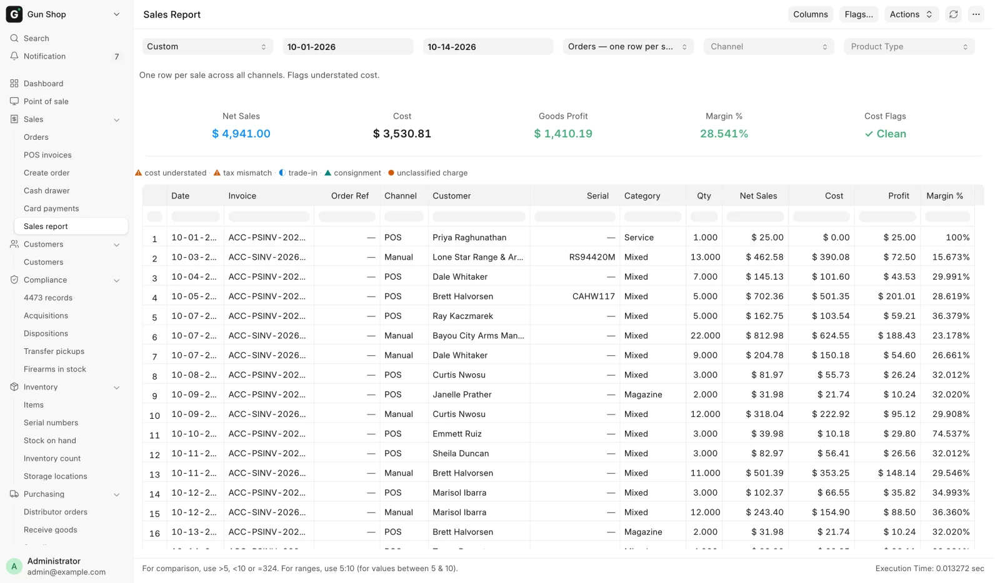
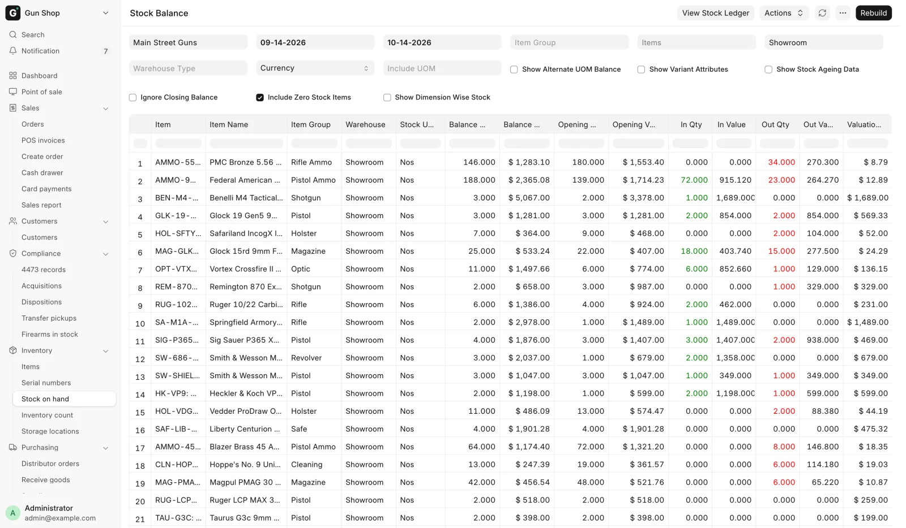
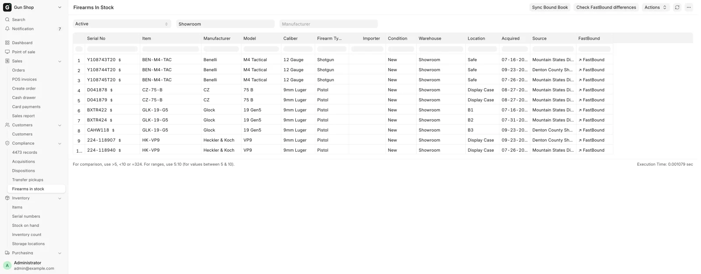
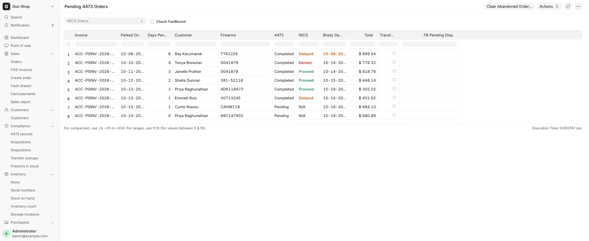
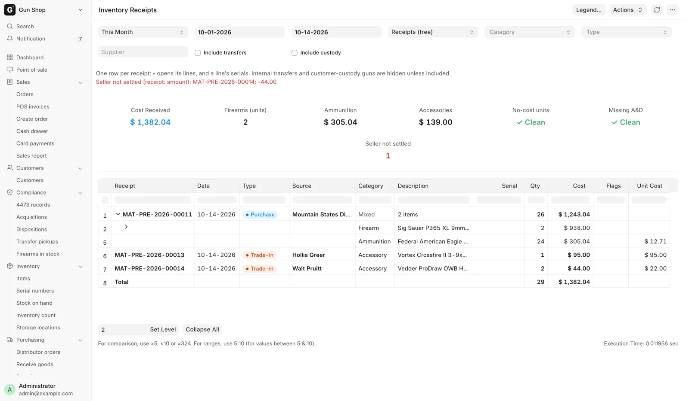

# Reports

This page lists every report in the system, who it is for and the question it answers. Managers and the bookkeeper live here. Counter staff mostly see the queues through the [Dashboard](../getting-started/dashboard.md), whose cards are cut from these same reports. Every report is also listed under **All records** at the foot of the Dashboard.

<figure markdown>
{ .screenshot }
<figcaption>Reports open as a filter bar, a summary strip and a table. Here the Sales Report over a custom date range, one row per sale.</figcaption>
</figure>

Reports open as a filter bar, a summary strip and a table.

## Every report

| Report | Route | Who it is for | The question it answers |
|---|---|---|---|
| Firearms In Stock | `/app/query-report/Firearms In Stock` | Inventory | Which guns do we physically have right now, by serial? |
| Pending 4473 Orders | `/app/query-report/Pending 4473 Orders` | Counter, manager | Which parked firearm sales are waiting on a 4473 or NICS? |
| Pending Transfer Pickups | `/app/query-report/Pending Transfer Pickups` | Counter | Whose transfer gun is in the safe, and how long has it sat? |
| Form 4473 Records | `/app/query-report/Form 4473 Records` | Counter, manager | Which 4473s are on file, and where is each signed form? |
| Cash Drawer Weekly | `/app/query-report/Cash Drawer Weekly` | Manager, bookkeeper | What moved the cash drawer each day, and did the count agree? |
| Inventory Receipts | `/app/query-report/Inventory Receipts` | Bookkeeper, inventory | What entered stock this period, from whom, at what cost? |
| Sales Report | `/app/query-report/Sales Report` | Manager, bookkeeper | What did we sell, across every channel, and what did we make? |
| Hand-Asserted 4473 Dispositions | `/app/query-report/Hand-Asserted 4473 Dispositions` | Manager | Which bound book entries did a person vouch for instead of FastBound? |
| GunBroker Statement Reconciliation | `/app/query-report/GunBroker Statement Reconciliation` | Bookkeeper | Does GunBroker's own bill agree with our ledger, order by order? |
| GunBroker Cash Basis Adjustments | `/app/query-report/GunBroker Cash Basis Adjustments` | Tax preparer | What bridges the accrual books to the cash-basis return? |
| Stock Balance | `/app/query-report/Stock Balance` | Inventory | How many of each item are on hand, per warehouse? |
| Stock Ledger | `/app/query-report/Stock Ledger` | Inventory | Every stock movement, one row per entry. |

Stock Balance and Stock Ledger are stock ERPNext reports. The sidebar links to Stock Balance under the name **Stock on hand**, in the **Inventory** group. Stock Balance runs in the background, so it opens empty until you set the filters and press Generate New Report. Once a run exists the button reads Rebuild.

Terminal card attempts on counter orders are a list rather than a report: **Card payments** in the sidebar's **Sales** group. See [Taking payment](../selling/payments.md).

<figure markdown>
{ .screenshot }
<figcaption>Stock Balance runs in the background, so it opens empty until you set the filters and press Generate New Report. Once a run exists the button reads Rebuild. This run covers one warehouse over a month.</figcaption>
</figure>

## The counter queues

**Firearms In Stock** lists every Serial No with status Active whose Item is a firearm, with manufacturer, model, caliber, condition, warehouse, its storage **Location** in the shop (blank when the gun is not placed), the acquisition date and source, and a link out to the gun's FastBound item record. Filter by Stock Status, Warehouse or Manufacturer. Two manager actions live on the toolbar: **Sync Bound Book** compares our in-stock list against FastBound and offers to remove guns FastBound reports as disposed, and **Check FastBound differences** starts a background field-by-field scan. Managers also get a small `$` link beside each serial that opens the correct-cost dialog.

<figure markdown>
{ .screenshot }
<figcaption>The by-serial floor view, opened on its filter bar. Stock Status, Warehouse and Manufacturer decide which serials list underneath.</figcaption>
</figure>

**Pending 4473 Orders** is one row per Draft POS Invoice that has a firearm line, with the 4473 status, the NICS status, days pending, the invoice total and a Transfer flag. The **Brady Day 3** column is three business days after the sale was parked. Denied shows red, Delayed shows orange, and a Delayed row past its Brady date has its date highlighted too. Antique firearms are excluded. Filter by NICS Status. See [Form 4473 at the counter](../compliance/4473.md).

<figure markdown>
{ .screenshot }
<figcaption>The parked-firearm queue, oldest first, with the Brady date.</figcaption>
</figure>

**Pending Transfer Pickups** lists every firearm received for a customer whose serial is still Active, oldest first, with the customer's mobile number and who shipped it. This is the call-the-customer queue. Filter by Customer.

**Form 4473 Records** lists every completed 4473 on file, from FastBound or on paper, newest first: when it was completed, the order, the customer, the firearms, the NICS result, the source and the order's status. **View PDF** opens the store's copy of the signed form. Filter by date, Customer, Serial, NICS Status or Source. See [4473 records](../compliance/4473-records.md).

## The back-office reports

**Inventory Receipts** covers everything that entered stock in a date range, sorted into four categories (Firearm, Ammunition, Accessory, Other) and ten receipt classes (such as Purchase, Trade-in, Intake, Return, Adjustment, Revaluation, Transfer and Custody). It has three views. Receipts is a tree of voucher, then lines, then serial units. Summary rolls up category by class. Units is one flat row per unit and is the grain to export. Internal transfers and customer-custody guns are hidden until you tick **Include transfers** or **Include custody**. Summary cards show Cost Received, firearm unit count, ammunition and accessory cost, and three flag counts: no-cost units, units missing an A&D entry, and **Seller not settled**. The last one counts purchases from a private seller whose seller payment does not match the receipt, and a red line under the filters names each receipt and the amount. Gun parts are counted in the accessory figures.

<figure markdown>
{ .screenshot }
<figcaption>Inventory Receipts, Receipts view. The summary cards total the whole period. Set Level and Collapse All, under the table, drive the voucher, lines and units tree.</figcaption>
</figure>

**Hand-Asserted 4473 Dispositions** is the standing review queue for every bound book entry a human vouched for rather than FastBound. Two doors write these: a manager forcing a stuck electronic 4473 through, and the counter recording a paper 4473 in Paper 4473 Mode. Each row shows when it was asserted, the serial, the disposition type, the invoice, who asserted it, their stated reason, and whether FastBound has since caught up. It shows the most recent 500 and has no filters. Read it periodically, or the control it audits means nothing.

**GunBroker Statement Reconciliation** matches GunBroker's own monthly bill against our ledger, order by order and item by item. Choose the statement (Fee Statement or Sales Tax Statement), the statement period, then either attach the CSV or paste the table into the text box. It never compares monthly totals: an order sold on 30 January and shipped on 2 February belongs to January's statement and February's ledger, so timing is a status of its own rather than a difference.

**GunBroker Cash Basis Adjustments** is the seven-item schedule the tax preparer works from. It takes a company and a period, and every figure is recomputed as of the period end rather than from today's status, so the same period end always gives the same schedule. Hand it to the accountant with the preamble printed at the top of the page. See [Month-end close](month-end.md).

**Cash Drawer Weekly** is one row per day of the cash drawer for a **Company** between **From** and **To**: the opening from the books, register sales, counter orders, customer payments, cash refunds, payments to sellers, bank deposits, cash from the bank, cash expenses and count differences, each with its documents, then the expected cash, the count, the difference and the reason. A day whose difference needed a reason shows red. The lines at the foot prove the days add up to the cash account, and list any ledger line that did not come from a sale, a payment or the Cash Drawer page. See [The cash drawer](../selling/cash-drawer.md).

## Filtering and exporting

Open a report and the filter bar sits above the table. Change a filter and the report re-runs. Sales Report and Inventory Receipts both have a **Period** picker with Today, This Week, This Month, Last Month, This Quarter and Year to Date. Editing From or To by hand puts the picker back to Custom.

To export, use the menu at the top right of the report page and choose **Export**, then pick Excel or CSV. On the Sales Report the Product view always exports its full tax column set no matter which columns you have hidden on screen.

Report access follows your role. Pending 4473 Orders and Pending Transfer Pickups open for counter and stock roles, and Form 4473 Records for Sales User, Sales Manager and System Manager. Firearms In Stock is stock roles only: Stock User, Stock Manager or System Manager. Sales Report needs Sales Manager, Accounts Manager or System Manager. Cash Drawer Weekly needs Sales Manager, Accounts User, Accounts Manager or System Manager. Inventory Receipts needs Stock Manager, Purchase Manager, Accounts User, Accounts Manager or System Manager. The two GunBroker reports need Accounts Manager or System Manager. See [Who can do what](../getting-started/roles.md).
